# system-to-doc — BA Kit

> Nhận một **hệ thống đã có sẵn** (website · source code · database · Figma)
>
> → AI tự khảo sát → dựng **bộ tài liệu baseline có version**
>
> → Về sau khi khách gửi **yêu cầu thay đổi (CR)**, AI đối chiếu baseline để trả lời CR ảnh hưởng tới đâu.

👉 Hướng dẫn chi tiết (có hình): [`docs/Hướng dẫn sử dụng System to Doc.docx`](docs/)

---

## 1. Hai luồng chính

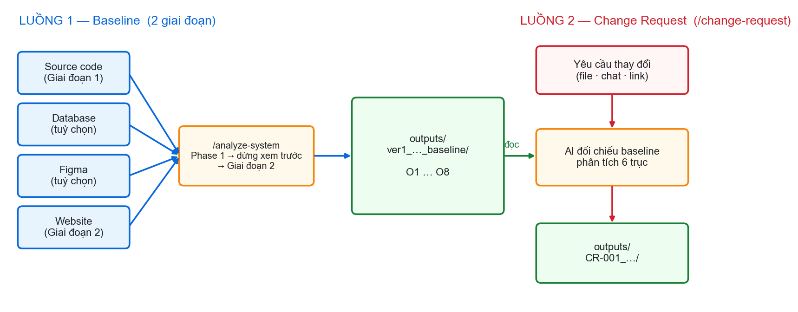

Kit gồm **2 lệnh** tương ứng **2 tình huống** thường gặp:

| | Luồng 1 — Baseline | Luồng 2 — Change Request |
|---|---|---|
| **Khi nào** | Lần đầu nhận dự án · hệ thống đã đổi nhiều | Khách gửi yêu cầu thay đổi |
| **Lệnh** | `/analyze-system` | `/change-request <file / link / nội dung>` |
| **AI đọc** | Website · Source · DB · Figma | Baseline mới nhất + nội dung CR |
| **Ra** | `outputs/ver<N>_<DDMMYY>_<tên>/` — bộ 8 output | `outputs/CR-<id>_<DDMMYY>_<tên>/` — impact 6 trục + 見積書 |

---

## 2. Vòng đời baseline

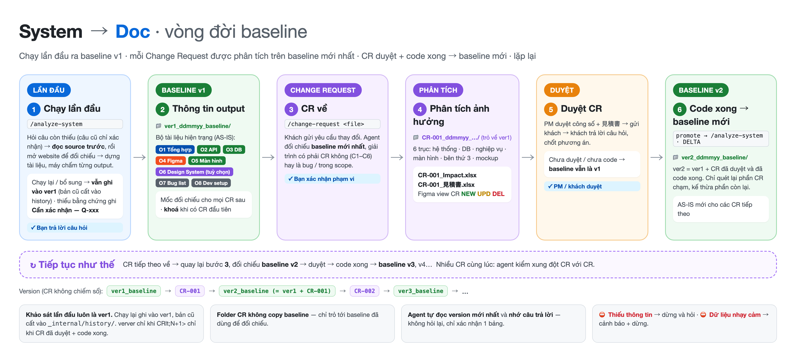

Nói đơn giản:

1. **Khảo sát lần đầu** → ver1 (baseline)
2. Khách gửi CR → **ver1 bị khoá**, tạo folder `CR-<id>_…` đối chiếu ver1
3. CR được **duyệt và code xong** → tạo **ver2** = ver1 + CR đó
4. Có CR mới → lặp lại từ bước 2

**AI tự quản version** — bạn chỉ gõ lệnh, không phải chỉ folder.

---

## 3. Chuẩn bị (1 lần)

Copy toàn bộ folder kit vào folder dự án → mở bằng Claude Code.

**Không cần cài gì thêm.**

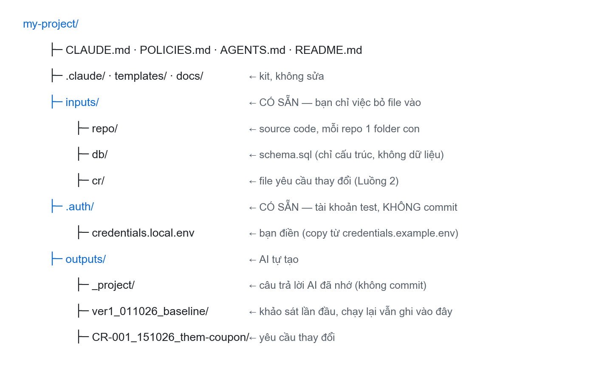

> 🔧 **Kit tự lo môi trường.**
>
> Khi chạy `/analyze-system` hoặc `/change-request`, AI tự kiểm tra và **tự cài** những gì còn thiếu:
>
> - Thư viện Python
> - Playwright + trình duyệt (khi quét website)
> - Kết nối Figma MCP (khi vẽ Figma)
>
> Việc duy nhất bạn có thể được nhờ: gõ `/mcp` → chọn **figma** → **Authenticate** (tài khoản Figma có quyền EDIT).
>
> Giai đoạn 1 cần **Node.js** có sẵn trên máy (cài 1 lần).

Kit **có sẵn các folder để bạn bỏ file vào** — AI tự tìm trước khi hỏi:

```
my-project/
├── CLAUDE.md · POLICIES.md · AGENTS.md · templates/ · .claude/    ← kit (không sửa)
│
├── inputs/                      ← có sẵn, mỗi folder con có README.md
│   ├── repo/                    ← source code: mỗi repo 1 folder con
│   ├── db/                      ← schema.sql — DUMP CHỈ CẤU TRÚC, không dữ liệu
│   └── cr/                      ← file CR của khách (Luồng 2)
│
├── .auth/                       ← tài khoản test — KHÔNG commit
│   ├── credentials.example.env  ← mẫu
│   └── credentials.local.env    ← bạn điền; script đọc, AI không đọc
│
└── outputs/                     ← AI tự tạo: ver1_… / CR-… / ver2_…
```

| Bạn có | Bỏ vào đâu |
|---|---|
| Source code | `inputs/repo/<tên-repo>/` (không có `.env`, key, `node_modules/`) |
| File DB | `inputs/db/schema.sql` |
| Tài khoản test website | `.auth/credentials.local.env` |
| Yêu cầu thay đổi | `inputs/cr/` |
| Website · Figma | Chỉ cần URL — AI hỏi khi chạy |

Nội dung `inputs/` và `.auth/` đã `.gitignore` — không bị commit.

---

## 4. Luồng 1 — Khảo sát hệ thống (chạy lần đầu)

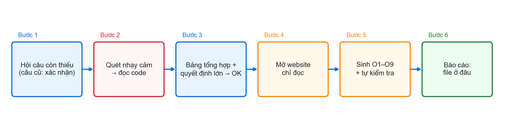

**1 lệnh, 2 giai đoạn** — có điểm dừng để bạn xem trước.

### Giai đoạn 1 — Đọc source code

- AI đọc source code (BE · FE · Mobile)
- **Không mở website** — nhanh, tốn ít thời gian
- Ra 6 output cơ bản
- Kết thúc: AI hỏi *"chạy tiếp Giai đoạn 2 hay dừng để review?"*

### Giai đoạn 2 — AI Playwright kiểm tra website

- Mở website thật, đối chiếu toàn bộ Giai đoạn 1
- Chụp ảnh màn hình, phát hiện chỗ khác code
- Thêm **O6 Design System** + **O7 Bug list**

```bash
cd my-project && claude

/analyze-system      # Giai đoạn 1 → AI dừng, hỏi chạy tiếp hay dừng để review
# chọn "dừng" → xem output → gọi lại:

/analyze-system      # AI đề xuất chạy tiếp Giai đoạn 2
```

### AI hỏi gì?

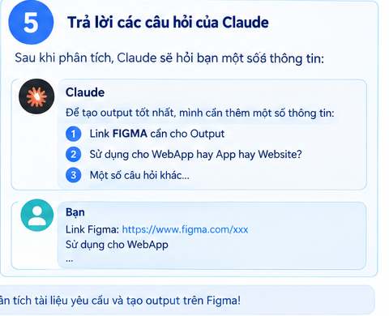

AI hỏi gom theo chủ đề, mỗi lượt ≤ 4 câu:

| Nhóm | AI hỏi | Bạn chuẩn bị |
|---|---|---|
| Phạm vi | Tên hệ thống · khảo sát tới đâu · **website hay app** | |
| Source code | Repo nào · FE/BE/Mobile · repo FE thuộc website nào | Repo đã bỏ vào `inputs/repo/` |
| Figma *(tuỳ chọn)* | Link design · link file để vẽ flow | Link `figma.com/design/...` |
| Website | Bao nhiêu site · URL · staging/production · tài khoản role nào · có được phép quét không | URL · tài khoản **test** |

> 🧠 **AI nhớ câu trả lời.**
>
> Lần chạy sau AI không hỏi lại — chỉ in bảng *"Tôi đang dùng các thông tin sau — có gì đổi không?"*
>
> Riêng 4 câu an toàn (thử nghiệm hay thật · tài khoản quét · mức thao tác · dữ liệu thật) luôn hỏi lại gọn *"vẫn như lần trước chứ?"*.

### Về mật khẩu

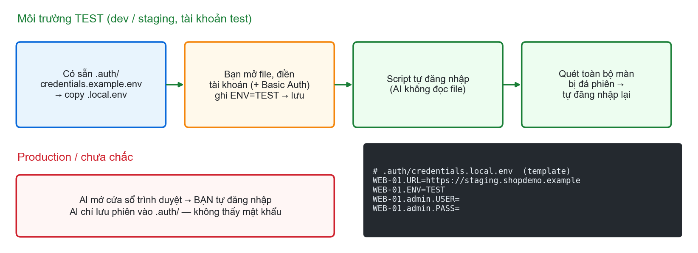

> ⚠️ **Mật khẩu KHÔNG gõ vào chat.**
>
> **Môi trường test (dev/staging, tài khoản test):**
> - Mở `.auth/credentials.local.env` → điền URL + tài khoản + ghi `ENV=TEST`
> - AI cho Playwright tự đăng nhập + tự đăng nhập lại khi mất phiên
> - AI **không đọc** file này; script từ chối nếu không phải `TEST`
>
> **Production / chưa chắc:**
> - AI mở trình duyệt, **bạn tự đăng nhập**
>
> `.auth/` không commit, không nằm trong output.
>
> Xong khảo sát → xoá file + đổi mật khẩu test.

### Output Luồng 1 — 8 output

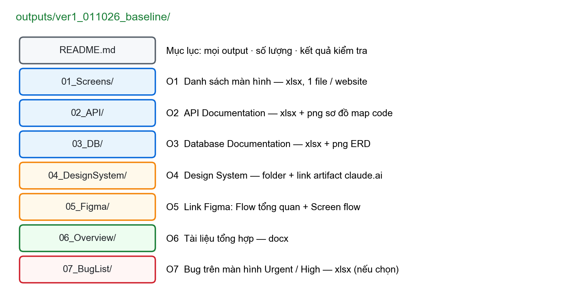

| # | Output | Giai đoạn | File |
|---|---|---|---|
| **O1** | **Tài liệu tổng hợp** — hình luồng nghiệp vụ (vẽ bằng Archify), tổng quan hệ thống, 1 bảng tổng màn / API / DB | 1 (cập nhật ở 2) | `01_Overview/Overview_….docx` |
| **O2** | **API Documentation** — mọi API theo group, làm gì, method, request, response | 1 | `02_API/API_Doc_….xlsx` |
| **O3** | **Database Doc** — tổng quan bảng, quan hệ, field · kiểu · format · ERD | 1 | `03_DB/DB_Doc_….xlsx` + `ERD_….png` |
| **O4** | **Figma flow** — Output 1 Flow + Output 2 Screen flow + sơ đồ DB | 1 | `04_Figma/figma-links.md` |
| **O5** | **Basic Design** — AI đọc code bằng AST (nguyên văn label, maxlength, error message) rồi viết theo nghiệp vụ. Giai đoạn 2 thêm ảnh | 1 · ảnh ở 2 | `05_Basic_Design/BasicDesign_WEB-01_….xlsx` |
| **O6** | *(tuỳ chọn)* **Design System** — brand book, màu, chữ, spacing, component | 2 | `06_Design_System/` |
| **O7** | **Bug list** — chỉ lỗi làm người dùng thao tác không được, mức High/Urgent | 2 | `07_Bug_List/BugList_….xlsx` |
| **O8** | **Hướng dẫn chạy local** — cho dev mới: lệnh cài, env keys (không giá trị) | 1 | `08_Huong_dan_chay_local/DevSetup_….md` |

### Ví dụ output thật

| Output | Ảnh |
|---|---|
| O1 Overview | 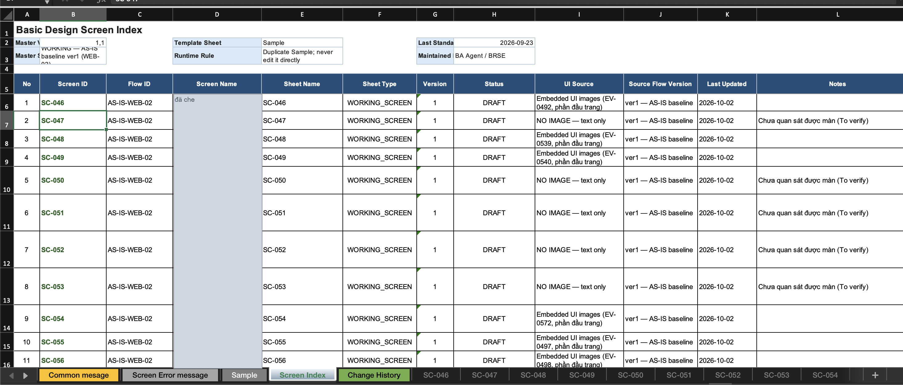 |
| O2 API | 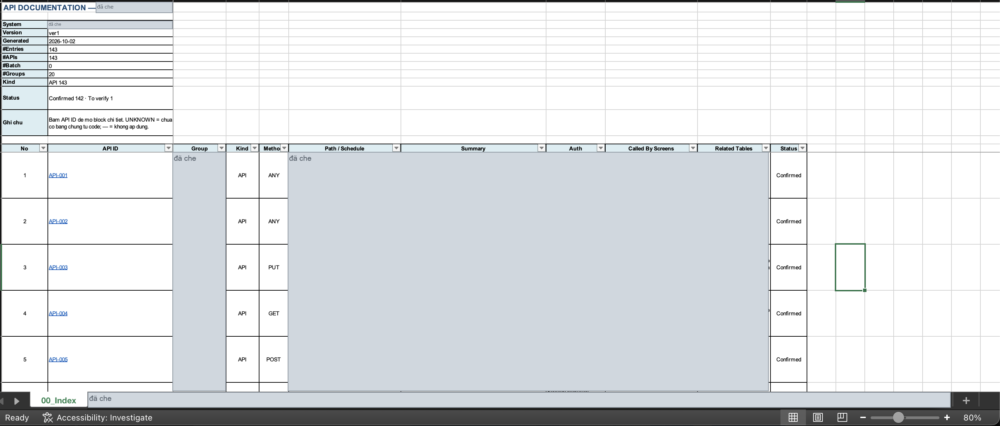 |
| O3 DB | 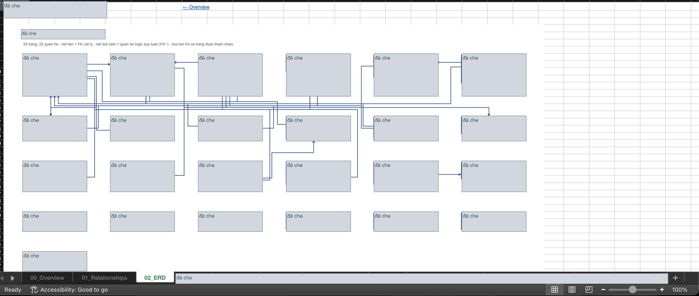 |
| O4 Figma | 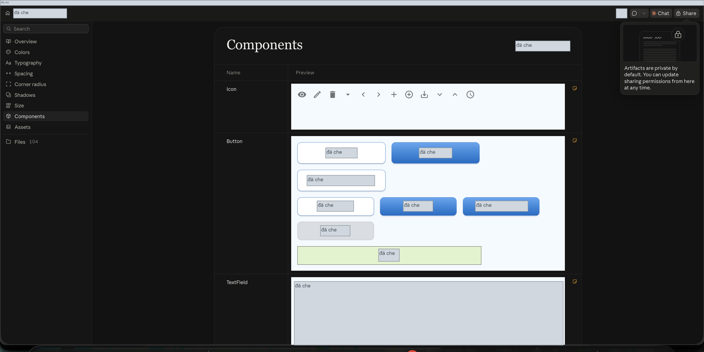 |
| O5 Basic Design | 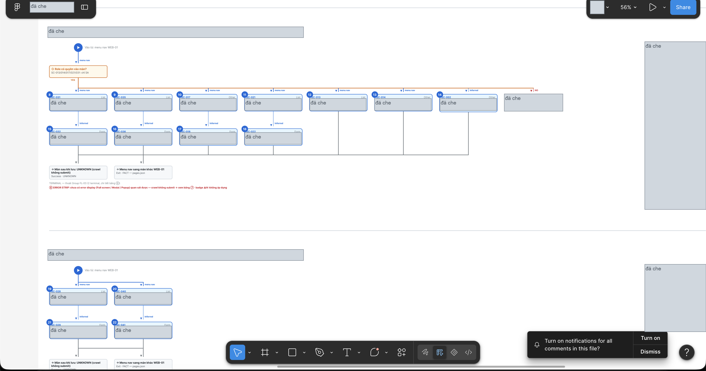 |
| O6 Design System | 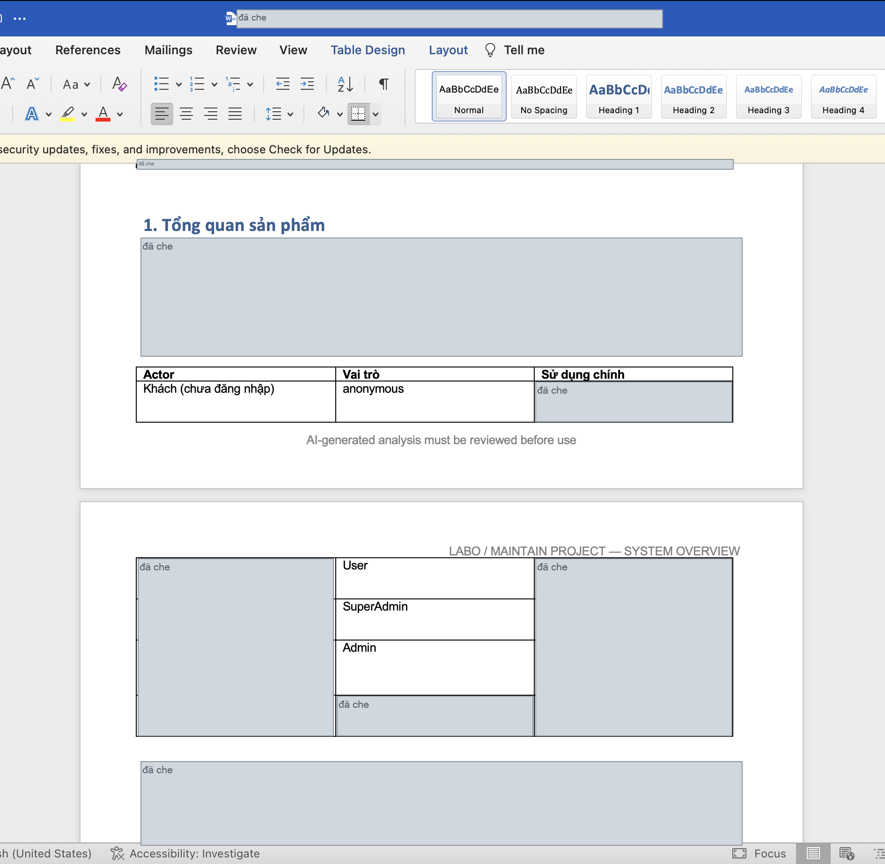 |
| O7 Bug list | 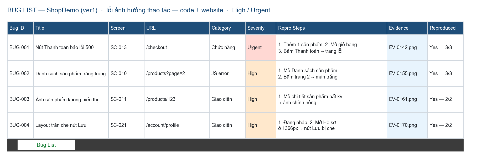 |

> 📏 **Mọi dòng trong tài liệu gắn với bằng chứng** (ảnh chụp, dòng code, schema).
>
> Không có bằng chứng → ghi **"Cần xác nhận — Q-xxx"** (JP: 「要確認 — Q-xxx」).
>
> **Không viết đại cho đẹp.**

---

## 5. Luồng 2 — Khi có 1 yêu cầu thay đổi


### Bước 1 — Đưa CR vào (1 trong 3 cách)

| Cách | Làm gì |
|---|---|
| **File** *(khuyến nghị)* | Bỏ file (`.docx` `.pdf` `.xlsx` `.md` ảnh) vào `inputs/cr/` → `/change-request inputs/cr/<tên>` |
| **Dán** | `/change-request` rồi dán nội dung |
| **Link** | `/change-request <link Backlog / Drive / Figma>` |

### Bước 2 — AI phân tích 6 trục

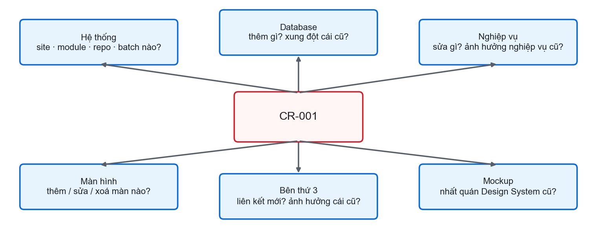

| Trục | AI trả lời |
|---|---|
| **Hệ thống** | CR tác động site / module / repo / batch nào |
| **Database** | Thêm gì? Xung đột với cái cũ không? |
| **Nghiệp vụ** | Sửa gì? Ảnh hưởng nghiệp vụ hiện tại không? |
| **Màn hình** | Thêm / sửa / xoá màn nào? |
| **Bên thứ 3** | Thêm liên kết nào? |
| **Mockup** | Màn mới có nhất quán với Design System không? |

Mỗi hạng mục gắn **badge**:

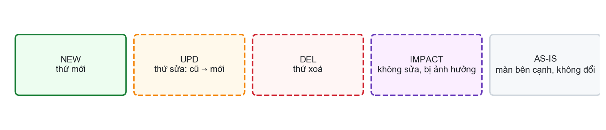

### Output Luồng 2

**`outputs/CR-<id>_<DDMMYY>_<tên>/`** gồm:

#### 📊 `CR-<id>_Impact.xlsx` — 7 sheet, gửi khách được

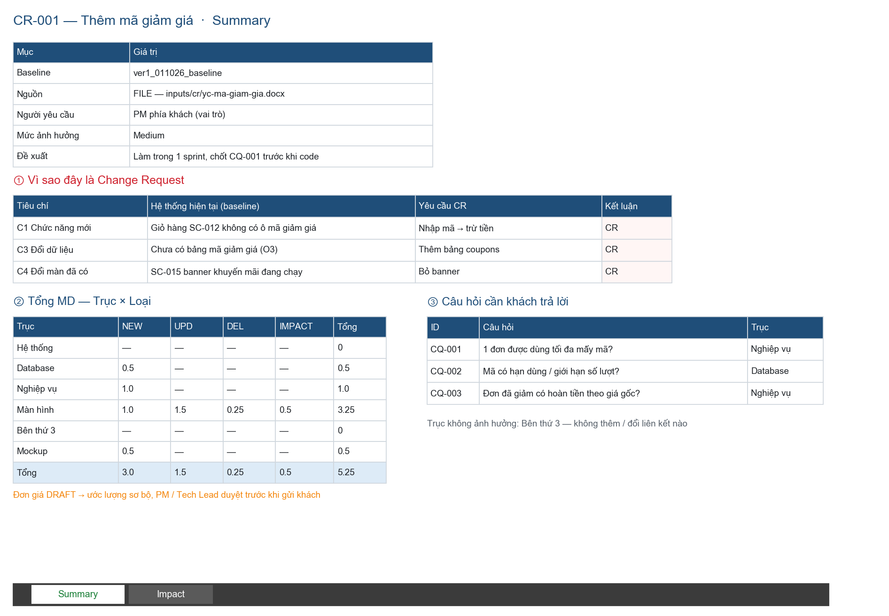

| Sheet | Nội dung |
|---|---|
| **Summary** | Số đối tượng thay đổi × NEW/UPD/DEL/IMPACT · link sang các sheet chi tiết |
| **Estimation** | Khung 見積書 của công ty — 1 dòng / hạng mục · 要件定義・UI/UX・テスト・管理 |
| **Screen · API · Database · Figma** | Từng hạng mục: Trục · Loại · Hạng mục · Nội dung thay đổi · Ảnh hưởng |
| **Q&A** | **Vì sao đây là CR** (C1–C6) · **câu hỏi KH** có **đề xuất câu trả lời** · mục không thuộc CR |

#### 💴 `CR-<id>_見積書.xlsx` — bản tiếng Nhật gửi khách

- Theo template `template_mitsumori.xlsx`
- 1 dòng / chức năng · 実装 MD · 要件定義 · UI/UX · テスト · 管理
- Tổng 人日 + 人月
- Sheet `前提条件・留意事項` + `確認事項` (câu hỏi nghiệp vụ)

#### 🎨 Figma view CR mới

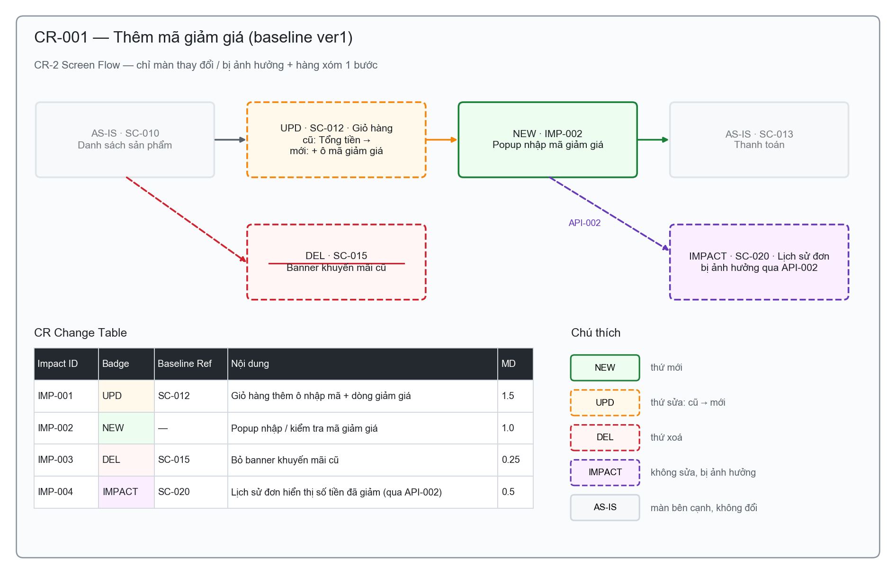

4 sub-view trong 1 section mới trên page FLOW:

| Sub-view | Format |
|---|---|
| **CR-1 Flow** | Output 1 — mỗi lane = 1 use case: Actor → đường đi → ✓ kết thúc · non-happy hàng dưới |
| **CR-2 Screen Flow** | Output 2 — site → flow → Group · Screen Index + Error/Popup Index |
| **CR Change Table** | **Thống kê** số đối tượng × NEW/UPD/DEL/IMPACT + 実装 MD + 人日 |
| **CR-3 Screens** | **Format Output 3** — mockup trái + mô tả/ITEMS/ERROR SCENARIOS phải. **Clone designer frame thật** để khớp UI |

> 💰 **MD** = đơn giá trong `.claude/config/md-unit-rates.json` × số lượng.
>
> AI chỉ chọn loại hạng mục, **không tự gõ số**.
>
> Bảng đơn giá đang **DRAFT** — PM / Tech Lead duyệt rồi đổi `status` thành `APPROVED`.

### Bước 3 — CR đã duyệt + đã code xong

Nói: *"CR-001 đã duyệt, đã code xong"* (hoặc chạy lại `/analyze-system`)

→ AI xác nhận lại rồi tạo **baseline mới** (ver2 = ver1 + CR đó)

---

## 6. Figma MCP — khi vẽ Figma

Giai đoạn 2 Luồng 1 + bước Figma Luồng 2 cần đăng nhập Figma 1 lần:

| Trạng thái | Ảnh |
|---|---|
| Chưa auth | 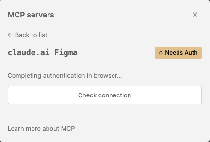 |
| Đã connect |  |

Bước đăng nhập:

1. Gõ `/mcp` trong Claude Code
2. Chọn **figma**
3. Chọn **Authenticate** — mở trình duyệt đăng nhập Figma
4. Quay lại Claude Code → AI tiếp tục

---

## 7. Cam kết của kit

| Cam kết | Cách thực thi |
|---|---|
| **Không bịa** | Mọi khẳng định gắn bằng chứng. Thiếu → ghi "Cần xác nhận — Q-xxx" + câu hỏi |
| **Không phá hệ thống** | Mặc định chỉ đọc. Gặp nút xoá/thanh toán vẫn dừng hỏi. Không bao giờ kết nối DB của khách |
| **Không làm lộ dữ liệu** | Quét nhạy cảm trước khi đọc. Hook chặn PII trước khi ghi / đẩy lên Figma. Mật khẩu không bao giờ vào file |
| **Tự chấm, không tự khen** | Mỗi output qua script kiểm tra. In số thật `N checks · X PASS · 0 FAIL` |

---

## 8. Cấu trúc folder `outputs/`

```
outputs/
├── _project/                              memory AI (câu trả lời đã nhớ, feedback)
│
├── ver1_011026_baseline/                  ← Luồng 1 lần đầu
│   ├── 01_Overview/
│   ├── 02_API/
│   ├── 03_DB/
│   ├── 04_Figma/
│   ├── 05_Basic_Design/
│   ├── 06_Design_System/
│   ├── 07_Bug_List/
│   ├── 08_Huong_dan_chay_local/
│   ├── README.md
│   ├── run-log.md
│   └── _internal/                          inventory + history + gates (không gửi KH)
│
├── CR-001_151026_them-coupon/              ← Luồng 2 — trỏ về ver1
│   ├── CR-001_Impact.xlsx
│   ├── CR-001_見積書.xlsx
│   ├── README.md
│   ├── run-log.md
│   └── _internal/
│
└── ver2_251026_baseline/                   ← ver1 + CR-001 (sau khi CR duyệt + code xong)
    └── (giống ver1)
```

---

## 9. Tài liệu chi tiết

- 📘 [`docs/Hướng dẫn sử dụng System to Doc.docx`](docs/) — hướng dẫn đầy đủ có hình
- 📜 [`CLAUDE.md`](CLAUDE.md) · [`POLICIES.md`](POLICIES.md) · [`AGENTS.md`](AGENTS.md) — rule cho AI agent
- ⚙️ `.claude/sys-agent/` — chi tiết từng output + từng gate kiểm tra
- 🔒 `.claude/rules/` — DATA-PRIVACY · SECURITY · RELIABILITY · POLICY
