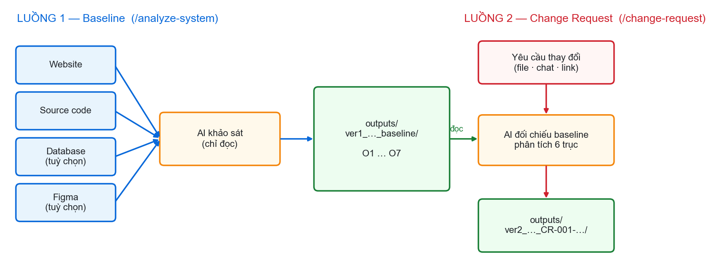
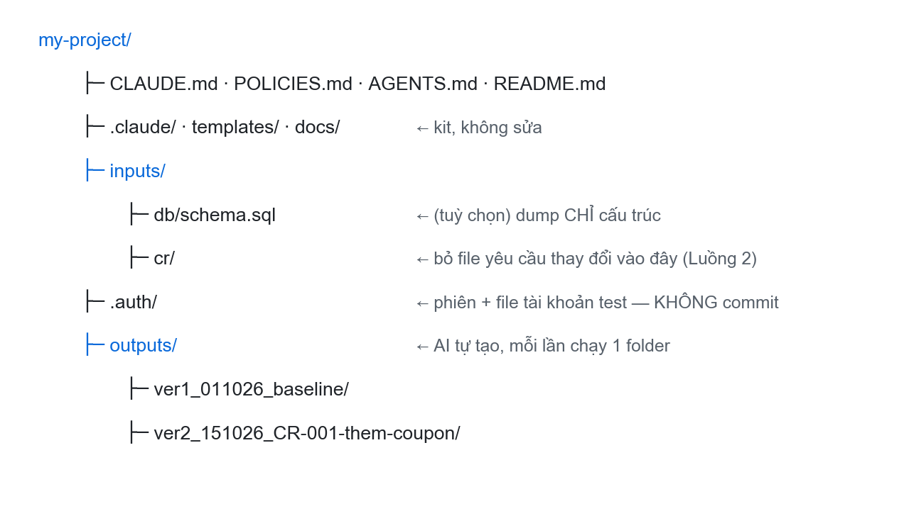
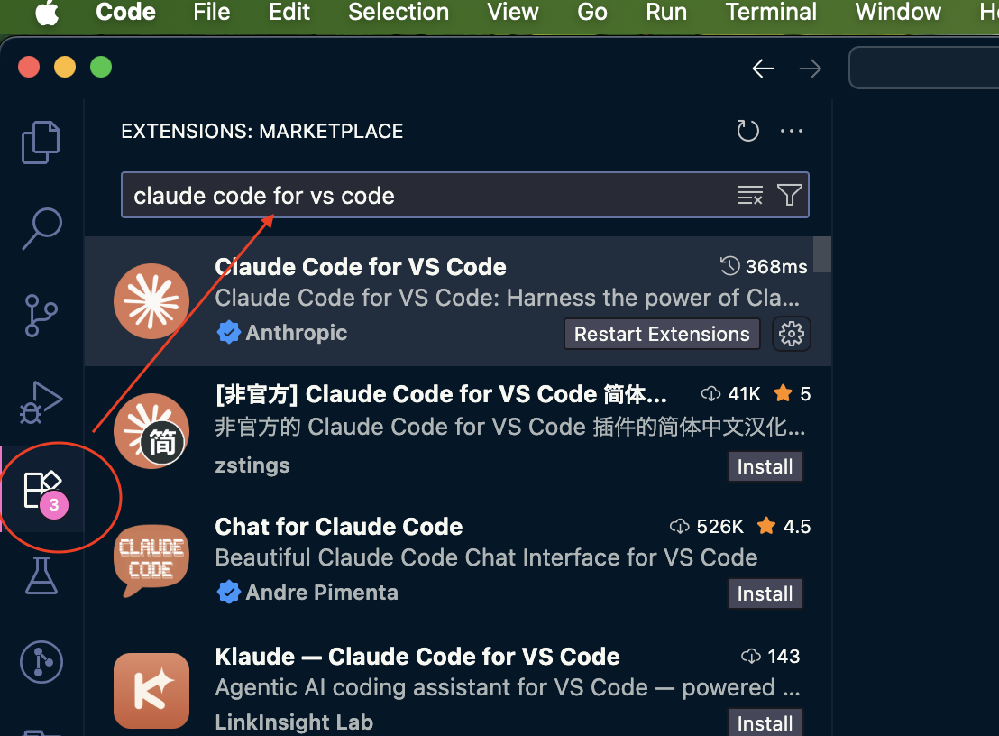
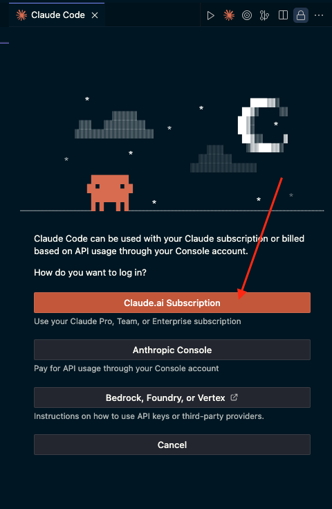
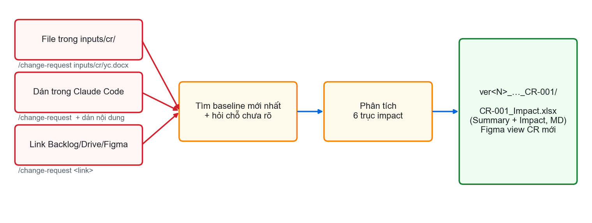
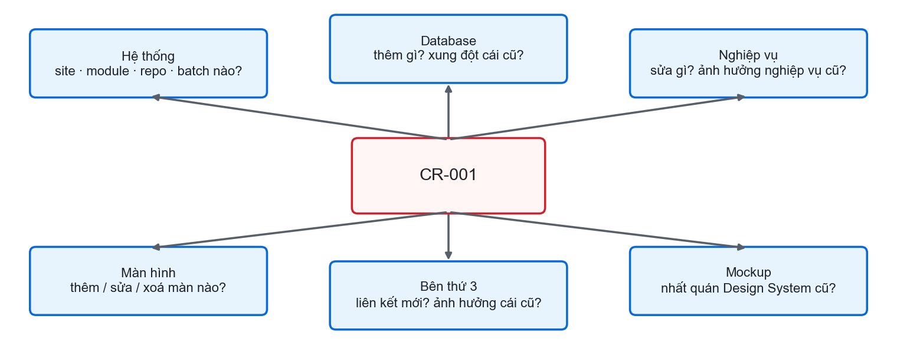
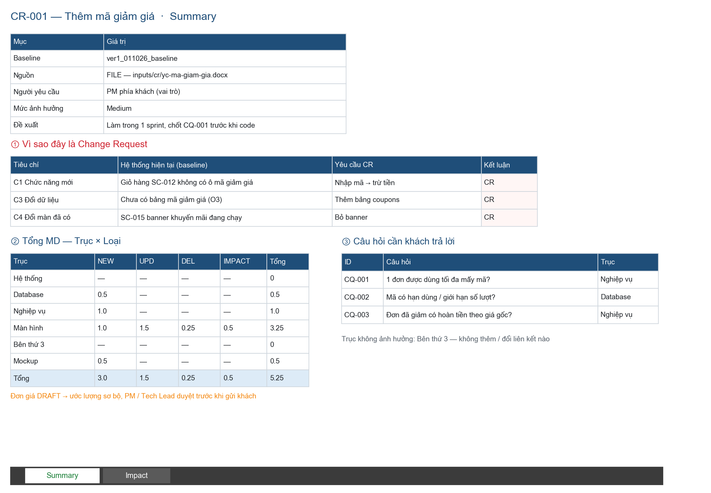
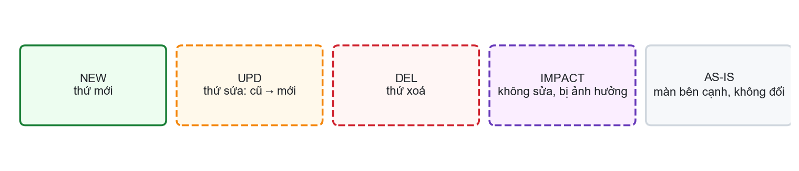
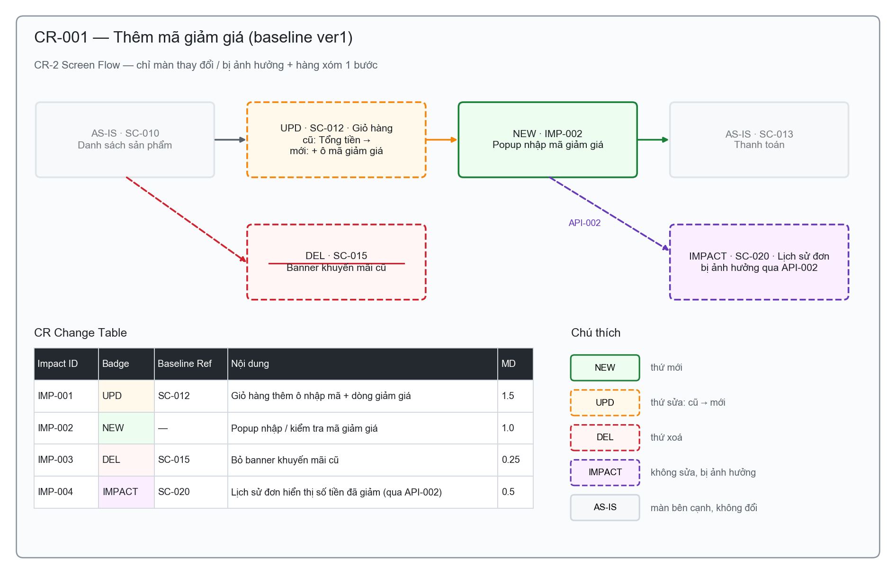
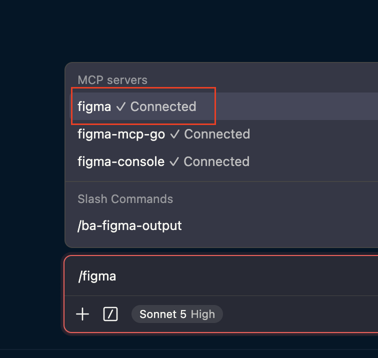

# system-to-doc — BA Kit (dự án KidoKido)

> Nhận một **hệ thống đã có sẵn** (website đang chạy · source code · database · Figma) → AI tự khảo sát → dựng **bộ tài liệu baseline có version** (Luồng 1). Về sau mỗi khi khách gửi **yêu cầu thay đổi (CR)**, AI đối chiếu baseline để trả lời CR ảnh hưởng tới đâu, tốn bao nhiêu MD (Luồng 2).
>
> Bản Word đầy đủ có hình: [`Hướng dẫn sử dụng System to Doc.docx`](Hướng%20dẫn%20sử%20dụng%20System%20to%20Doc.docx)



| | Luồng 1 — Baseline | Luồng 2 — Change Request |
|---|---|---|
| Khi nào | Lần đầu nhận dự án · hệ thống đã đổi nhiều | Khách gửi yêu cầu thay đổi |
| Lệnh | `/analyze-system` | `/change-request <file / link / nội dung>` |
| Đọc | Website · Source · DB · Figma | Baseline mới nhất + nội dung CR |
| Ra | `outputs/ver<N>_<DDMMYY>_<tên>/` — 7 output | `outputs/ver<N>_<DDMMYY>_CR-<id>-<tên>/` — impact 6 trục + MD |
| **Trạng thái dự án này** | ✅ **Đã chạy** → `outputs/ver1_021026_khao-sat-lan-dau/` | 👉 **Dùng từ đây trở đi** — xem [Luồng 2](#luồng-2--khi-có-1-yêu-cầu-thay-đổi) |

---

## Mục lục

1. [Chuẩn bị (1 lần)](#1-chuẩn-bị-1-lần)
2. [Baseline hiện có — kết quả Luồng 1](#2-baseline-hiện-có--kết-quả-luồng-1)
3. [Luồng 2 — khi có 1 yêu cầu thay đổi](#luồng-2--khi-có-1-yêu-cầu-thay-đổi)
4. [Version và chạy lại](#4-version-và-chạy-lại)
5. [Một số lỗi khi dùng](#5-một-số-lỗi-khi-dùng)
6. [Kit cam kết](#6-kit-cam-kết)

---

## 1. Chuẩn bị (1 lần)

> Máy đã chạy Luồng 1 thì bước này **đã xong** — bỏ qua, xuống [mục 3](#luồng-2--khi-có-1-yêu-cầu-thay-đổi).

### 1.1 Folder dự án

**Link tải kit (Google Drive):** https://drive.google.com/drive/folders/1BxmyquEekgBwGmhYGdK_7s10s_DYmSGF — tải zip, giải nén, copy toàn bộ nội dung vào folder dự án. Kiểm tra có `outputs/ver1_021026_khao-sat-lan-dau/` (baseline) và `inputs/cr/`.

Phải có folder `.claude/` nằm ngay trong folder dự án (trên Mac folder này bị ẩn — bấm `Shift + Command + .` để hiện, hoặc mở bằng VS Code). Luồng 2 dùng thêm `inputs/cr/` để bỏ file yêu cầu thay đổi.



### 1.2 Mở Claude Code

Cài extension **Claude Code for VS Code** (Anthropic) → đăng nhập bằng **Claude.ai Subscription** → mở folder dự án. Hoặc dùng Terminal: `cd <folder dự án>` rồi gõ `claude`.

| Cài extension | Đăng nhập |
|---|---|
|  |  |

> 🔧 **Không cần cài thư viện hay kết nối gì thêm.** Khi chạy `/change-request` (hoặc `/analyze-system`), AI tự kiểm tra và **tự cài** những gì còn thiếu: thư viện Python, Playwright + trình duyệt (chỉ khi quét website), kết nối Figma MCP (chỉ khi vẽ Figma).
> Việc duy nhất bạn có thể được nhờ: khi AI báo Figma chưa xác thực → gõ `/mcp` → chọn **figma** → **Authenticate**, đăng nhập Figma bằng tài khoản công ty cấp (liên hệ QA), có quyền **EDIT**.

---

## 2. Baseline hiện có — kết quả Luồng 1

Luồng 1 đã chạy xong. Luồng 2 sẽ **tự tìm baseline mới nhất** này để đối chiếu — không cần chạy lại Luồng 1.

**Folder:** [`outputs/ver1_021026_khao-sat-lan-dau/`](outputs/ver1_021026_khao-sat-lan-dau/) — mở [`README.md`](outputs/ver1_021026_khao-sat-lan-dau/README.md) trong folder để xem mục lục + kết quả gate.


| # | Output | File | Số lượng |
|---|---|---|---|
| O1 | Danh sách màn hình (Basic Design) | `01_Screens/BasicDesign_WEB-01_ver1.xlsx` · `BasicDesign_WEB-02_ver1.xlsx` | 45 + 48 sheet màn |
| O2 | API Documentation + Code map | `02_API/API_Doc_KidoKido_ver1.xlsx` · `CodeMap_KidoKido_ver1.png` | 143 API |
| O3 | Database Documentation + ERD | `03_DB/DB_Doc_KidoKido_ver1.xlsx` · `ERD_KidoKido_ver1.png` | 25 bảng · 323 cột |
| O4 | Design System (WEB-01, WEB-02) | `04_DesignSystem/WEB-0x/` + link artifact claude.ai trong README version | DRAFT |
| O5 | Figma flow | `05_Figma/figma-links.md` | 3 link |
| O6 | Tài liệu tổng hợp | `06_Overview/Overview_KidoKido_ver1.docx` | 1 |
| O7 | Bug list | `07_BugList/BugList_KidoKido_ver1.xlsx` | 0 bug |

> Luồng 2 dùng baseline này để: lấy mã màn `SC-xxx`, API `API-xxx`, bảng/cột DB, token Design System làm **Baseline Ref** cho từng hạng mục impact. Thứ gì baseline ghi `UNKNOWN` / "cần xác minh" thì CR chạm vào đó sẽ bị AI hỏi lại, không tự đoán.

---

## Luồng 2 — khi có 1 yêu cầu thay đổi



### Bước 1 — Chuẩn bị nội dung CR

- **Che dữ liệu cá nhân trước khi đưa vào:** tên / email / SĐT người gửi, khách hàng cuối, số đơn hàng thật → thay bằng **vai trò** (`PM phía khách`) hoặc dữ liệu mẫu (`user_a@example.com`, `SO-0001`). Hook vẫn chặn nếu quên, nhưng đừng dựa vào nó.
- 1 CR = 1 chủ đề. Khách gửi 1 email có nhiều yêu cầu không liên quan → tách thành nhiều file, chạy nhiều lần (mỗi lần 1 mã CR).
- Ảnh mockup / ảnh chụp email cũng dùng được — chỉ cần ảnh **không có dữ liệu thật**.

### Bước 2 — Đưa CR vào và gọi lệnh

| Cách | Làm gì |
|---|---|
| **File** *(khuyến nghị)* | Bỏ file (`.docx` `.pdf` `.xlsx` `.md` `.png` ảnh chụp email/mockup) vào `inputs/cr/` → gõ `/change-request inputs/cr/<tên-file>` |
| **Dán trực tiếp** | Gõ `/change-request` rồi dán nội dung yêu cầu vào Claude Code |
| **Link** | `/change-request <link Backlog / Drive / Figma>` — AI đọc qua connector; không đọc được thì nhờ bạn tải file về `inputs/cr/` |

Ví dụ:

```text
/change-request inputs/cr/yc-them-ma-giam-gia.docx
```

> Trước khi đọc file, AI chạy quét nhạy cảm. Phát hiện secret / dữ liệu thật → AI **dừng**, báo file nào, loại gì và hỏi cách xử lý (gỡ file / đưa bản đã che / xác nhận là dữ liệu giả).

### Bước 3 — Trả lời câu hỏi của AI

AI hỏi bằng hộp chọn — chọn đáp án hoặc gõ vào ô *Other*. **AI không tự chọn thay bạn.**

| Câu | Khi nào | AI hỏi | Bạn chọn |
|---|---|---|---|
| **CR-0** | Luôn hỏi | CR có `n` item, đối chiếu với baseline `ver1_021026_khao-sat-lan-dau` (số site · màn · API · bảng); CR khác đang mở (nếu có) | `[A]` Đúng baseline, mã CR = `CR-<id>` (gõ *Other* để đổi mã/tiêu đề) · `[B]` Hệ thống đã đổi → chạy Luồng 1 **Delta** trước · `[C]` Dùng baseline khác |
| **CR-1** | Chỉ khi CR mơ hồ (≤ 4 câu / lượt) | Đúng chỗ thiếu, VD "1 đơn dùng tối đa mấy mã?" | Trả lời nếu biết. **Không biết** → để AI ghi thành câu hỏi `CQ-xxx` gửi khách |
| **CR-2** | Sau khi xong file Impact | Có vẽ view CR lên Figma không | `[A]` Cùng file flow của baseline · `[B]` File/page khác (dán link) · `[C]` Không vẽ lần này |

> **AI hỏi link Figma** → điền `https://www.figma.com/design/jjyE9GhFfRZ5VDZU8HFIPv/TOKIWAGI-PJ?node-id=16779-398` (cũng là file flow baseline ver1 — AI chỉ thêm section CR mới, không sửa node cũ).

### Bước 4 — AI phân loại và phân tích 6 trục

Mỗi item trong CR được phân loại bằng bằng chứng từ baseline:

| Nhãn | Nghĩa | Đi đâu |
|---|---|---|
| **CR** | Thoả ≥ 1 tiêu chí C1–C6 bên dưới | Sheet `Impact` + giải trình "vì sao là CR" |
| **BUG** | Khách mô tả đúng hành vi baseline đã ghi là phải có, nhưng hệ thống chạy sai | Mục "Không thuộc CR" — đề nghị đưa vào bug list, không tính MD CR |
| **QUESTION** | Khách hỏi hệ thống đang làm gì | AI trả lời từ baseline (kèm ID + bằng chứng) → mục "Không thuộc CR" |
| **CHƯA RÕ** | Chạm vùng baseline `UNKNOWN` / `To verify` | Hỏi CR-1, không tự chọn nhãn |

| Tiêu chí | Là CR khi |
|---|---|
| **C1** | Chức năng / màn / API / bảng **mới**, chưa có trong hệ thống hiện tại |
| **C2** | Đổi hành vi đang chạy đã `Confirmed` trong baseline (khách đổi ý, không phải lỗi) |
| **C3** | Thêm / bỏ màn, actor, chức năng, liên kết bên thứ 3 |
| **C4** | Đổi business rule / validation đang chạy |
| **C5** | Đổi nền tảng / thiết bị / yêu cầu phi chức năng (hiệu năng, bảo mật, trình duyệt) |
| **C6** | Kéo theo đổi schema DB, API contract hoặc tài liệu đã bàn giao |

Sau đó AI trả lời đủ **6 câu hỏi** cho CR — trục nào không ảnh hưởng cũng phải ghi lý do:



| Trục | Trả lời |
|---|---|
| Hệ thống | CR tác động tới site / module / repo / batch nào |
| Database | Thêm gì? Xung đột với bảng/cột cũ không? Đổi kiểu / NOT NULL / FK trên cột đang dùng → kéo theo API/màn nào |
| Nghiệp vụ | Sửa gì? Ảnh hưởng nghiệp vụ hiện tại không? |
| Màn hình | Thêm / sửa / xoá màn nào? Xoá màn → liệt kê màn đang dẫn tới nó |
| Bên thứ 3 | Thêm liên kết nào (chỉ ghi **tên** config key, không giá trị)? Ảnh hưởng liên kết cũ không? |
| Mockup | Màn mới/sửa dùng lại token / component nào của Design System cũ? Cần thứ chưa có → dòng `UI-TOKEN-NEW` + câu hỏi cho designer |

### Bước 5 — Nhận kết quả

AI in: folder version mới · baseline đã dùng · số hạng mục theo trục × loại · **tổng MD** · xung đột · câu hỏi cần khách trả lời · link Figma (nếu vẽ).

```
outputs/ver2_<DDMMYY>_CR-001-<tên-ngắn>/
├── README.md                  mục lục version
├── run-log.md                 ghi baseline đã dùng (ver1_021026_khao-sat-lan-dau)
├── input/                     CR nguyên văn (đã che dữ liệu cá nhân)
├── CR-001_Impact.xlsx         2 sheet: Summary · Impact   ← gửi khách được
├── 05_Figma/figma-links.md    link view CR (nếu vẽ)
└── _internal/                 dữ liệu máy đọc + kết quả gate — không gửi khách
```

#### `CR-<id>_Impact.xlsx` — 2 sheet

- **`Summary`** — gửi khách được: thông tin CR · **① vì sao đây là CR** (đối chiếu hệ thống hiện tại theo C1–C6) · **② tổng MD** theo Trục × Loại · trục không ảnh hưởng + lý do · **③ câu hỏi cần khách trả lời** · mục không thuộc CR (BUG / QUESTION).
- **`Impact`** — 1 dòng / hạng mục: Impact ID · Trục · Loại (`NEW` / `UPD` / `DEL` / `IMPACT`) · Baseline Ref · Nội dung thay đổi · **Vì sao phải sửa** · Ảnh hưởng tới hiện tại · Xung đột · Rủi ro · Mã đơn giá · Số lượng · **MD** · Evidence · Câu hỏi.


<sub>Ví dụ sheet Summary — dữ liệu giả ShopDemo.</sub>

> ⚠️ **MD** = đơn giá trong `.claude/config/md-unit-rates.json` × số lượng — **script tính**, AI chỉ chọn mã đơn giá + số lượng, không gõ số. Bảng đơn giá hiện đang **`DRAFT`** → Summary ghi "Ước lượng sơ bộ". PM / Tech Lead duyệt rồi đổi `status` thành `APPROVED` trước khi gửi số MD cho khách. **Không sửa tay MD trong xlsx** — gate V-CR sẽ báo FAIL.

#### Figma — view CR mới

- 1 section **mới** đặt dưới bản baseline — **không vẽ đè, không sửa node cũ**.
- Chỉ vẽ phần thay đổi + phần bị ảnh hưởng + màn bên cạnh 1 bước; tô màu theo badge, kèm **CR Change Table** (Impact ID · badge · Baseline Ref · nội dung · MD).



| Badge | Nghĩa |
|---|---|
| `NEW` (xanh lá, viền liền) | Thứ mới |
| `UPD` (cam, viền đứt) | Thứ sửa: cũ → mới |
| `DEL` (đỏ, viền đứt) | Thứ xoá |
| `IMPACT` (tím, viền đứt) | Không sửa nhưng bị ảnh hưởng |
| `AS-IS` (xám) | Màn bên cạnh, không đổi |


<sub>Ví dụ view CR trên Figma — dữ liệu giả ShopDemo.</sub>

### Bước 6 — Sau khi nhận kết quả

| Tình huống | Làm gì |
|---|---|
| Khách trả lời các câu `CQ-xxx` | Chạy lại `/change-request` với nội dung CR + câu trả lời → ra **version mới** (không sửa version cũ) |
| Muốn góp ý cách AI phân tích | Ghi vào mục **Feedback** trong `run-log.md` của version CR rồi chạy lại |
| CR đã được code xong trong hệ thống | Chạy `/analyze-system` chọn **Delta** → baseline mới cho các CR sau |
| Có CR khác đang mở cùng sửa 1 chỗ | AI tự cảnh báo trong mục đề xuất — kiểm tra trước khi báo giá |

> ✅ Checklist trước khi gửi `CR-<id>_Impact.xlsx` cho khách: bảng đơn giá đã `APPROVED` · đã đọc mục Xung đột / Rủi ro `High` · không còn tên / email thật (AI đã chạy `detect-pii.js --scan`, nhưng ảnh chèn vào thì máy không đọc được — tự nhìn lại).

---

## 4. Version và chạy lại

```
outputs/
├── ver1_021026_khao-sat-lan-dau/       Luồng 1 — baseline (đã có)
├── ver2_<DDMMYY>_CR-001-<tên>/          Luồng 2 — trỏ về ver1
└── ver3_<DDMMYY>_baseline-delta/        Luồng 1 Delta sau khi CR-001 đã code xong
```

- Mỗi lần chạy = 1 folder mới `ver<N>_<ngày>_<tên>`. **Không bao giờ sửa folder cũ.**
- Muốn góp ý → ghi vào mục **Feedback** trong `run-log.md` của version rồi chạy lại.

---

## 5. Một số lỗi khi dùng

**1 — AI báo "chưa có baseline" và dừng**
Luồng 2 không tìm thấy folder baseline trong `outputs/`. Kiểm tra `outputs/ver1_021026_khao-sat-lan-dau/` còn nguyên (kể cả `_internal/inventory.xlsx`) và Claude Code đang mở đúng folder dự án.

**2 — AI nhờ xác thực Figma**
AI đã tự thêm kết nối Figma, chỉ còn bước đăng nhập phải do người bấm. Gõ `/mcp` trong Claude Code → chọn **figma**: thấy **Needs Auth** → bấm xác thực, đăng nhập Figma trên trình duyệt (tài khoản công ty cấp, có quyền **EDIT** file TOKIWAGI-PJ); đúng là `figma ✓ Connected`. Không thấy figma trong `/mcp` → khởi động lại Claude Code rồi thử lại. Chưa xác thực được thì AI vẫn ra file Impact, chỉ bỏ phần vẽ Figma.

| Chưa xác thực | Đã kết nối |
|---|---|
|  |  |

**3 — AI không đọc được link Backlog / Drive**
Connector chưa kết nối hoặc không có quyền. Tải file về `inputs/cr/` rồi chạy lại với đường dẫn file.

**4 — AI dừng vì phát hiện dữ liệu cá nhân / secret trong file CR**
Đây là chủ đích. Che thông tin (dùng vai trò / dữ liệu mẫu) rồi chạy lại, hoặc trả lời AI đó là dữ liệu giả.

**5 — MD trong file khác số khách mong đợi**
Không sửa tay trong xlsx. Sửa đơn giá trong `.claude/config/md-unit-rates.json` (PM / Tech Lead duyệt) hoặc góp ý số lượng trong mục Feedback của `run-log.md`, rồi chạy lại.

**6 — AI báo không tự cài được môi trường (`BLOCKED`)**
Thường do máy chưa có Node.js (chỉ cần khi quét website ở Luồng 1 Delta) hoặc mạng chặn tải thư viện. Gửi nguyên thông báo của AI cho người phụ trách kit / IT; phần không phụ thuộc vẫn chạy tiếp.

---

## 6. Kit cam kết

| Cam kết | Cách thực thi |
|---|---|
| **Không bịa** | Mọi khẳng định gắn bằng chứng; Baseline Ref phải có thật trong baseline; thiếu thì ghi `UNKNOWN` + câu hỏi |
| **Không phá hệ thống** | Mặc định chỉ đọc; không bao giờ kết nối DB của khách; Figma chỉ thêm section mới, không sửa node cũ |
| **Không làm lộ dữ liệu** | Quét nhạy cảm trước khi đọc, hook chặn PII trước khi ghi / đẩy lên Figma, mật khẩu không bao giờ vào file |
| **Tự chấm, không tự khen** | Mỗi output qua script kiểm tra (V-CR · V-CR-FIGMA), in số thật `N checks · X PASS · 0 FAIL`; MD do script tính |
