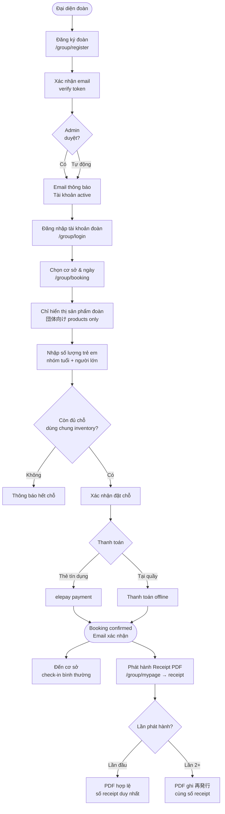

# SPEC: Đăng ký và đặt chỗ theo đoàn (Group Booking)

## Mô tả nghiệp vụ

Hệ thống hiện chỉ hỗ trợ đặt chỗ cá nhân (bảo hộ / phụ huynh). Tính năng này bổ sung luồng riêng cho **đoàn** (幼稚園・保育園 và các tổ chức tương tự): trang booking riêng chỉ hiển thị sản phẩm đoàn, quản lý thông tin tổ chức + người phụ trách, thanh toán theo đoàn, và phát hành receipt PDF.

**Lý do tách riêng:** Nếu hiển thị sản phẩm đoàn cùng trang cá nhân, số lượng sản phẩm tăng nhiều → khó chọn cho khách lẻ. Ngoài ra thông tin cần thu thập (tên tổ chức, người phụ trách, địa chỉ thanh toán...) không có trong flow cá nhân.

## Flow nghiệp vụ

## Actors & Preconditions

| Actor | Vai trò |
|---|---|
| Group Representative (担当者) | Người đại diện đoàn thực hiện đặt chỗ và thanh toán |
| Group Admin Account | Mỗi đoàn có thể có nhiều tài khoản; tất cả thuộc về 1 đoàn |
| System Admin | Duyệt đoàn mới, quản lý đặt chỗ đoàn, xem lịch sử |
| Store Manager | Xem đặt chỗ đoàn của cửa hàng mình |

**Preconditions cho Group Representative:**
- Đoàn đã đăng ký và được admin duyệt (hoặc tự xác nhận — TBD: immediate/approval)
- Ít nhất 1 sản phẩm được đánh dấu "đoàn" trong quản lý sản phẩm
- Còn chỗ trống tại store trong ngày muốn đặt

## Happy Path

### Module 1: Đăng ký đoàn mới

1. Đại diện đoàn truy cập URL đăng ký đoàn (tách biệt với URL cá nhân)
2. Điền form: tên đoàn/pháp nhân, địa chỉ, SĐT, thông tin người phụ trách, người chịu trách nhiệm ngày sự kiện, địa chỉ thanh toán, tên trên receipt
3. Xác nhận email (email verification link)
4. (TBD) Admin duyệt hoặc tự động activate
5. Đại diện đoàn nhận email xác nhận tài khoản đã hoạt động

### Module 2: Đặt chỗ theo đoàn

1. Đại diện đăng nhập tài khoản đoàn
2. Truy cập trang đặt chỗ đoàn (URL riêng, chỉ hiển thị sản phẩm đoàn)
3. Chọn: cửa hàng → ngày → giờ sử dụng → sản phẩm đoàn
4. Nhập: số lượng trẻ em, số lượng người lớn/người đi kèm, phân theo nhóm tuổi (TBD)
5. Nhập người phụ trách ngày sự kiện, ghi chú
6. Xác nhận booking → (TBD) xác nhận ngay hoặc chờ admin duyệt
7. Nhận email xác nhận đặt chỗ

### Module 3: Thanh toán

1. Sau khi booking được confirm, đại diện đoàn vào trang thanh toán
2. Chọn phương thức: thẻ tín dụng (elepay — đã có) hoặc thanh toán tại quầy (TBD)
3. Hoàn thành thanh toán → nhận email xác nhận thanh toán

### Module 4: Phát hành Receipt PDF

1. Sau khi thanh toán thành công, đại diện vào My Page → mục Receipt
2. Click "Phát hành receipt" → hệ thống generate PDF
3. PDF lần đầu: hợp lệ, có số receipt duy nhất, tên/địa chỉ từ thông tin đoàn
4. PDF lần 2 trở đi: in thêm chữ "再発行" + ngày tái phát hành
5. Nếu bị cancel/refund: receipt bị vô hiệu hóa hoặc đánh dấu "取消"

### Module 5: My Page đoàn

1. Đại diện xem thông tin đoàn, cập nhật khi cần
2. Xem danh sách đặt chỗ hiện tại và lịch sử
3. Thay đổi/hủy đặt chỗ (trong phạm vi deadline TBD)
4. Xem trạng thái thanh toán
5. Phát hành receipt

### Module 6: Admin Panel — quản lý đoàn

1. Admin xem/tìm kiếm đoàn (theo tên, người phụ trách)
2. Admin duyệt đoàn mới (nếu approval flow được bật)
3. Admin xem đặt chỗ đoàn, thay đổi/hủy khi cần
4. Admin xem trạng thái thanh toán, lịch sử receipt
5. Store manager chỉ thấy đặt chỗ của cửa hàng mình

## Alternative Flows & Edge Cases

| Case | Xử lý |
|---|---|
| Chỗ trống không đủ cho số lượng đoàn | Thông báo rõ số chỗ còn lại, không cho đặt quá capacity; dùng chung inventory với booking cá nhân |
| Email verification hết hạn | Cho phép gửi lại email xác nhận từ trang đăng nhập |
| Đại diện muốn thay đổi số lượng sau khi đặt | Cho phép sửa trước deadline (TBD); nếu giảm chỗ → hoàn tiền một phần theo policy TBD |
| Hủy booking | Áp dụng cancellation fee theo policy TBD; refund phần còn lại qua elepay |
| Thanh toán bằng thẻ thất bại | Hiển thị lỗi từ elepay, cho phép thử lại; booking vẫn hold trong thời gian ngắn (TBD) |
| Admin duyệt đoàn → reject | Đại diện nhận email thông báo từ chối + lý do; tài khoản vẫn tồn tại nhưng không thể đặt |
| Receipt phát hành sau khi refund | Receipt cũ bị đánh dấu "取消"; nếu partial refund → issue receipt mới với amount sau refund |
| Thay đổi tên trên receipt sau lần phát hành đầu | Lưu lịch sử tên cũ; lần tái phát hành dùng tên mới; ghi log thay đổi |
| Đăng nhập từ thiết bị mới (2FA trigger) | (TBD) Gửi OTP email/SMS; không enforce 2FA thường xuyên |
| Nhiều tài khoản cùng đoàn | Tất cả account thuộc đoàn đều thấy đặt chỗ và lịch sử của đoàn |
| Invoice payment (請求書払い) | (TBD) — chờ xác nhận từ client |

## Acceptance Criteria

**AC-1: Đăng ký đoàn và xác nhận email**
- Given: Người dùng chưa có tài khoản
- When: Điền form đăng ký đoàn đầy đủ và submit
- Then: Nhận email xác nhận; sau khi click link → tài khoản active; có thể đăng nhập

**AC-2: Trang đặt chỗ đoàn chỉ hiển thị sản phẩm đoàn**
- Given: Đại diện đoàn đăng nhập, vào trang booking đoàn
- When: Chọn store và ngày
- Then: Chỉ hiển thị sản phẩm có category "団体向け"; sản phẩm "一般向け" không xuất hiện

**AC-3: Inventory dùng chung với booking cá nhân**
- Given: Store có capacity 50 chỗ ngày 15/8; booking cá nhân đã chiếm 30 chỗ
- When: Đoàn muốn đặt 25 chỗ
- Then: Hệ thống báo chỉ còn 20 chỗ, không cho phép đặt 25

**AC-4: Booking đoàn thành công**
- Given: Đại diện chọn store, ngày, sản phẩm, số lượng hợp lệ
- When: Submit đặt chỗ
- Then: Booking được tạo (status: confirmed hoặc pending tùy config TBD); email xác nhận được gửi; capacity giảm tương ứng

**AC-5: Thanh toán thẻ tín dụng**
- Given: Booking ở trạng thái chờ thanh toán
- When: Đại diện thanh toán qua elepay thành công
- Then: Booking status → "paid"; email xác nhận thanh toán gửi đến đại diện; lịch sử thanh toán lưu

**AC-6: Phát hành receipt lần đầu**
- Given: Thanh toán thành công
- When: Đại diện click "Phát hành receipt"
- Then: PDF được generate với số receipt duy nhất, tên/địa chỉ đoàn, amount, store, ngày sử dụng; trạng thái "初回発行" lưu vào DB với timestamp

**AC-7: Tái phát hành receipt**
- Given: Receipt đã phát hành lần đầu
- When: Đại diện click "Phát hành" lần 2
- Then: PDF giống lần đầu nhưng có thêm chữ "再発行" và ngày tái phát hành; receipt number giữ nguyên

**AC-8: Receipt bị vô hiệu hóa khi cancel**
- Given: Booking đã có receipt phát hành, sau đó bị hủy toàn bộ
- When: Admin/đại diện hủy booking
- Then: Receipt cũ bị đánh dấu "取消" trong DB; PDF nếu download lại phải có watermark/status "取消"

**AC-9: Admin tìm kiếm đặt chỗ đoàn**
- Given: Admin ở màn hình quản lý đặt chỗ đoàn
- When: Search theo tên đoàn = "ABC幼稚園"
- Then: Hiển thị tất cả đặt chỗ của đoàn đó, không lẫn với booking cá nhân

**AC-10: Store manager chỉ thấy store của mình**
- Given: Store manager A quản lý Store X
- When: Vào admin panel xem đặt chỗ đoàn
- Then: Chỉ thấy đặt chỗ tại Store X; không thấy đặt chỗ tại Store Y

**AC-11: Nhiều tài khoản trong cùng đoàn**
- Given: Đoàn ABC có 2 tài khoản: account1 và account2
- When: account1 đặt chỗ thành công
- Then: account2 đăng nhập vào My Page cũng thấy đặt chỗ đó trong danh sách

**AC-12: Đăng nhập an toàn — giới hạn số lần thử**
- Given: Có người thử đăng nhập sai mật khẩu nhiều lần
- When: Đạt ngưỡng (TBD số lần)
- Then: Tài khoản tạm thời bị khóa; gửi email thông báo cho chủ tài khoản

## Screens

**Group Portal (URL riêng, tách biệt):**
- `/group/register` — Đăng ký đoàn mới
- `/group/login` — Đăng nhập tài khoản đoàn
- `/group/booking` — Trang đặt chỗ (chỉ hiện sản phẩm đoàn)
- `/group/booking/[id]` — Chi tiết đặt chỗ, thanh toán
- `/group/mypage` — My Page: thông tin đoàn, lịch sử đặt chỗ, receipt

**Admin Panel (mở rộng từ admin hiện có):**
- `Admin > Groups` — Danh sách đoàn, duyệt/tạm dừng
- `Admin > Group Bookings` — Tìm kiếm đặt chỗ đoàn (filter: store, ngày, tên đoàn, người phụ trách)
- `Admin > Group Bookings > [id]` — Chi tiết, cho phép sửa/hủy, xem lịch sử receipt
- `Admin > Group Bookings > Export CSV` — Xuất danh sách

**Product Management (mở rộng từ admin hiện có):**
- Thêm trường "公開区分" (publication type): 一般向け | 団体向け | 一般・団体共通
- Sản phẩm đoàn sẽ không hiển thị trên trang booking cá nhân

## Out of Scope

- Không làm mobile app cho group booking (chỉ web trong lần này)
- Không làm AI-based recommendation hay smart pricing cho đoàn
- Invoice payment (請求書払い) — chờ xác nhận client, không đưa vào MVP
- Approval flow (admin duyệt booking) — TBD, không đưa vào scope đến khi chốt
- Thống kê nâng cao / báo cáo group (chỉ làm search + CSV export cơ bản)
- Integration LINE Notify cho group (chỉ email trong lần này)
- Quản lý tuổi từng trẻ em cá nhân (chỉ nhập số lượng theo nhóm tuổi nếu cần — TBD)

## Open Questions

1. **Approval flow:** Đoàn đăng ký xong có cần admin duyệt trước khi đặt chỗ được không, hay tự activate sau email verification?
2. **Booking confirmation:** Đặt chỗ đoàn → confirm ngay hay cần admin approve từng booking?
3. **Minimum group size:** Số người tối thiểu để áp dụng giá đoàn là bao nhiêu?
4. **Nhóm tuổi trẻ em:** Nhập tổng số hay nhập từng nhóm tuổi (ví dụ: 3-4 tuổi, 5-6 tuổi)? Có bao nhiêu nhóm?
5. **Miễn phí / giảm giá cho người đi kèm:** Điều kiện cụ thể là gì?
6. **Cancellation deadline và fee:** Bao nhiêu ngày trước, fee bao nhiêu %?
7. **Payment hold time:** Sau khi đặt, booking giữ chỗ bao lâu trước khi tự hủy nếu chưa thanh toán?
8. **Invoice payment (請求書払い):** Có yêu cầu không? (Tài liệu ghi "→請求書発行必要そう" nhưng chưa chốt)
9. **2FA cho tài khoản đoàn:** Chỉ trigger khi nào (thiết bị mới? thao tác quan trọng?)
10. **Sản phẩm chung (一般・団体共通):** Client xác nhận có sản phẩm loại này không?
11. **Receipt content / kế toán requirements:** Client cần confirm với kế toán về các trường bắt buộc trên receipt PDF.
12. **Booking change deadline:** Thay đổi số lượng được phép đến khi nào? Có phí không?
13. **Admin duyệt đoàn → từ chối:** Có cần ghi lý do không? Có giới hạn số lần đăng ký lại không?
