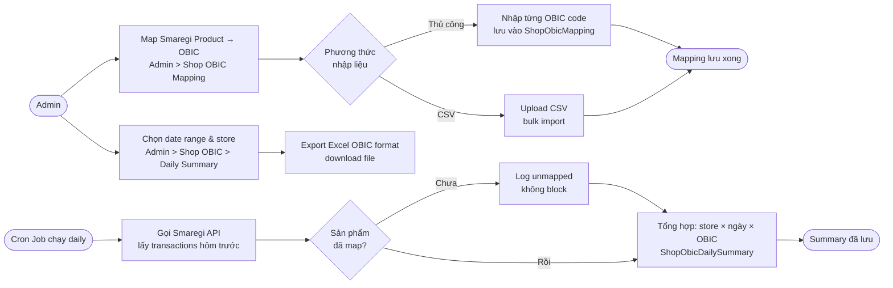

# SPEC: Bổ sung OBIC tổng hợp doanh thu Shop (Smaregi)

## Mô tả nghiệp vụ

Hệ thống OBIC hiện chỉ tổng hợp doanh thu từ booking/ticket (đặt chỗ trực tuyến). Tính năng này mở rộng sang doanh thu bán lẻ tại quầy (shop) thông qua Smaregi POS.

Luồng: Smaregi POS → API lấy sản phẩm và giao dịch → Admin map OBIC code cho từng sản phẩm → Cron job tổng hợp daily → Admin xuất Excel nộp OBIC.

**Điểm khác biệt với OBIC booking hiện có:**
- OBIC booking: tính từ charge lines của booking trong DB tokiwagi
- OBIC shop: lấy giao dịch từ Smaregi API, map qua master riêng, không có booking tương ứng trong DB

## Flow nghiệp vụ

## Actors & Preconditions

- **Actor:** Admin (quản lý hệ thống, không phải user cuối)
- **Preconditions:**
  - Tenant đã bật tính năng Smaregi (`SmaregiEnabledContext`)
  - Smaregi API credentials đã được cấu hình cho tenant
  - OBIC codes danh sách đã có (import từ client)

## Happy Path

### Flow 1: Admin map OBIC code cho Smaregi products

1. Admin vào trang "Shop OBIC Mapping" (admin panel)
2. Hệ thống gọi Smaregi API lấy danh sách sản phẩm shop của tenant
3. Admin thấy bảng: Smaregi product (tên, mã) | OBIC code (input)
4. Admin nhập OBIC code cho từng sản phẩm và Save
5. Hệ thống lưu mapping vào DB (bảng ShopObicMapping)

### Flow 2: CSV bulk import mapping

1. Admin tải CSV template (gồm cột: smaregi_product_id, product_name, obic_code)
2. Admin điền OBIC codes, upload file
3. Hệ thống validate: sản phẩm tồn tại trong Smaregi, OBIC code hợp lệ format
4. Import thành công → ghi đè mapping cũ, log lịch sử

### Flow 3: Daily aggregation (Cron job)

1. Cron job chạy mỗi ngày (giờ cố định, TBD)
2. Gọi Smaregi API lấy transaction details trong ngày hôm trước (theo business day của store)
3. Xử lý: loại trừ return/cancel, áp dụng discount theo logic đã chốt (TBD)
4. Group by: store × business_date × obic_code → tổng qty và amount
5. Lưu vào bảng ShopObicDailySummary
6. Flag sản phẩm chưa có OBIC mapping → log warning, không block

### Flow 4: Export Excel OBIC

1. Admin chọn date range + store (optional)
2. Hệ thống generate Excel từ ShopObicDailySummary
3. Format Excel: tương tự format OBIC booking hiện có (`obic-codes/export.ts`), confirm với client
4. Admin download file

## Alternative Flows & Edge Cases

| Case | Xử lý |
|---|---|
| Smaregi API timeout/lỗi khi lấy products | Hiển thị thông báo lỗi, giữ nguyên mapping cũ; không update |
| Smaregi API lỗi trong cron job | Ghi log lỗi, gửi alert admin; không xóa data cũ; cho phép re-run thủ công |
| Sản phẩm chưa được map OBIC | Ghi vào bảng riêng (unmapped), hiển thị trong admin để xử lý, không block export |
| Return/cancel transaction trong ngày | Trừ ra khỏi tổng (net sales); logic cụ thể TBD — xem mục Open Questions |
| Discount / coupon trong Smaregi | Xử lý theo policy hiện tại của booking OBIC; cần confirm với client |
| Smaregi product bị xóa/thay đổi tên | Giữ mapping cũ theo product_id; hiển thị warning nếu product không còn tồn tại |
| Re-run aggregation cho ngày đã xử lý | Cho phép re-run, ghi đè; lưu lịch sử lần chạy |
| CSV upload sai format | Trả lỗi rõ ràng từng dòng, không import một phần |

## Acceptance Criteria

**AC-1: Lấy Smaregi products thành công**
- Given: Admin đã vào trang Shop OBIC Mapping, tenant có Smaregi enabled
- When: Trang load
- Then: Hiển thị danh sách sản phẩm lấy từ Smaregi API (tên + mã), obic_code hiện tại nếu đã map

**AC-2: Save mapping thủ công**
- Given: Admin đã nhập OBIC code cho một sản phẩm
- When: Admin nhấn Save
- Then: Mapping được lưu vào DB; lần sau mở lại vẫn hiển thị đúng OBIC code đó

**AC-3: CSV bulk import thành công**
- Given: CSV hợp lệ (đúng format, product_id tồn tại, obic_code không rỗng)
- When: Admin upload
- Then: Mapping được ghi đè cho toàn bộ rows trong CSV; log import được tạo với timestamp + số dòng

**AC-4: CSV import lỗi**
- Given: CSV có 1 dòng sai format (obic_code rỗng)
- When: Admin upload
- Then: Không có dòng nào được import; admin thấy danh sách lỗi theo row

**AC-5: Cron job aggregate daily thành công**
- Given: Cron job chạy, Smaregi API available, tất cả products đã có OBIC mapping
- When: Job hoàn tất
- Then: ShopObicDailySummary có data cho ngày hôm trước, group đúng theo store × obic_code

**AC-6: Cron job gặp sản phẩm chưa map**
- Given: Có 1 giao dịch với sản phẩm chưa có OBIC mapping
- When: Cron job chạy
- Then: Giao dịch đó được log vào bảng unmapped_shop_transactions; không block toàn bộ job; data các sản phẩm đã map vẫn được lưu

**AC-7: Export Excel**
- Given: Có data trong ShopObicDailySummary cho date range đã chọn
- When: Admin click Export
- Then: File Excel được download, format đúng chuẩn OBIC, mỗi row là 1 obic_code × store × date

**AC-8: Smaregi API lỗi trong cron job**
- Given: Smaregi API trả lỗi khi cron job đang chạy
- When: Job gặp lỗi
- Then: Không có data mới nào được commit; log lỗi với timestamp + error detail; admin có thể re-run thủ công cho ngày đó

## Screens

**1. Admin > Shop OBIC > Product Mapping**
- Bảng: Smaregi Product ID | Product Name | Current OBIC Code (editable) | Last Updated
- Nút: Save Changes, Download CSV Template, Upload CSV
- Filter: search by product name

**2. Admin > Shop OBIC > Daily Summary**
- Filter: date range + store
- Table: Date | Store | OBIC Code | Product Count | Total Qty | Total Amount
- Nút: Export Excel, Re-run Aggregation (cho ngày cụ thể)

**3. Admin > Shop OBIC > Unmapped Products**
- Danh sách sản phẩm chưa có OBIC mapping và giao dịch tương ứng
- Link sang màn hình mapping để xử lý

## Out of Scope

- Không tích hợp Smaregi real-time (chỉ batch/cron job)
- Không làm UI cho end-user (khách mua hàng tại shop) — chỉ admin
- Không sync ngược từ tokiwagi sang Smaregi (tokiwagi chỉ đọc)
- Không làm error/re-run dashboard nâng cao trong MVP (chỉ re-run thủ công qua nút)
- Không tự động điền OBIC code (không có AI suggest) — admin map thủ công hoặc CSV
- Không thay đổi OBIC booking feature hiện có

## Open Questions

1. **Smaregi API endpoint cho transactions:** API `reconcile-smaregi-transactions` hiện có lấy giao dịch "仮販売" (tạm bán). Cần confirm: shop OBIC sẽ dùng endpoint khác (giao dịch hoàn tất) hay cùng endpoint?
2. **Return/discount xử lý:** Logic return và discount trong shop OBIC có giống booking không? (booking trừ khi cancel, discount tính trên net amount). Cần confirm với client.
3. **Business date:** Khi nào cắt ngày? Cùng timezone store hay UTC? Nếu store đóng lúc 22:00 thì giao dịch sau 22:00 tính vào ngày nào?
4. **OBIC Excel format:** Format file Excel giống hoàn toàn với booking OBIC export hay có cột khác? Cần client xác nhận.
5. **Cron job schedule:** Chạy lúc mấy giờ? Có cần chạy multiple stores song song không?
6. **Multi-tenant:** Chạy cho tất cả tenants có Smaregi enabled hay chỉ một tenant cụ thể?
7. **Smaregi product sync frequency:** Danh sách sản phẩm lấy fresh mỗi lần admin mở trang hay cache? Nếu cache thì TTL bao lâu?
