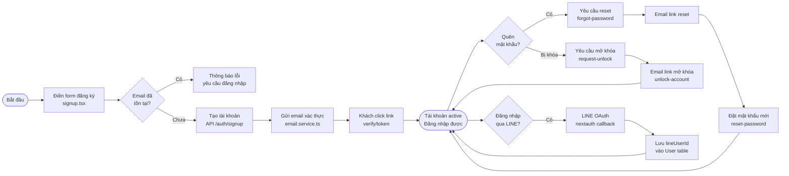

# Flow 2 — Đăng ký & Xác thực

Luồng đăng ký tài khoản mới, xác nhận email, khôi phục mật khẩu và mở khóa tài khoản.

## Ghi chú tính năng mới (2026-08)

- **LINE user ID (KIDOKIDO-2063):** khi khách đăng nhập bằng LINE, `lineUserId` được lưu vào bảng `User` (migration `20260728000000_add_line_user_id_to_users`). Fix bug cũ: một user tiêu dùng nhầm `lineUserId` của user khác. Bổ sung API export danh sách LINE user ID và script backfill dữ liệu cũ.

