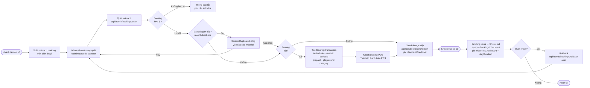

# Flow 6 — Check-in tại cơ sở

Luồng vận hành tại cơ sở: quét mã vạch, check-in/check-out, tích hợp POS Smaregi và rollback khi quét nhầm.

## Ghi chú tính năng mới (2026-08)

- **ConfirmDuplicateDialog (KIDOKIDO-2095):** khi quét lại mã vạch đã check-in trong khoảng thời gian gần, dialog yêu cầu nhân viên xác nhận trước khi tiếp tục để tránh scan trùng.
- **Gray-out vé tháng/năm (KIDOKIDO-2098):** từ lần scan thứ 2 trở đi trong ngày, entry vé tháng / vé năm hiển thị mờ (gray) để phân biệt với scan mới.
- **Booking history mở rộng (KIDOKIDO-2085):** booking detail/history hiển thị `firstCheckinAt`, `firstCheckoutAt`, và `stayDuration` — hỗ trợ Admin xem thời gian lưu lại đầu tiên (không bị recheck-in ghi đè).
- **Smaregi transaction cải tiến (KIDOKIDO-2092, 2104, 2106):**
  - `taxInclude` áp dụng cho prepaid transaction (đảm bảo giá đã bao gồm thuế).
  - Sử dụng `deviceId` thật của terminal thay vì `terminalId` tạm.
  - Tự động chọn playground category mặc định cho mỗi transaction.
  - Recheck-in nhiều vé offline tính đúng tổng tiền (fix bug tính sai).
- **Timeout transaction tăng (KIDOKIDO-2082):** tránh crash khi fetch booking-by-user lớn ở giờ cao điểm.
