# Flow 9 — Admin Setup cơ sở

Luồng admin cấu hình hệ thống trước khi mở đặt vé và theo dõi vận hành hàng ngày.

```mermaid
flowchart LR
    A([Admin đăng nhập]) --> B[Tạo Tenant / Cơ sở\n/admin/tenant-management]
    B --> C[Cấu hình GMO Merchant\n/api/admin/gmo-settings]
    C --> D[Tạo Gói Vé\n/admin/ticket-management]
    D --> E[Cấu hình Lịch đặt vé\nticket-booking-schedules]
    E --> F[Cài đặt mẫu Email\n/admin/email-settings]
    F --> G[Đăng tin tức / Điều khoản\n/admin/news-management]
    G --> H([Cơ sở sẵn sàng\nKhách có thể đặt vé])

    H --> I[Theo dõi hàng chờ\n/admin/booking-queue]
    I --> J[Quản lý quét vé\n/admin/scan-management]
    J --> K[Xem trạng thái chỗ trống\n/admin/vacancies-status]
    K --> L[Xuất doanh thu & OBIC\n/admin/revenue-management]
```

## Ghi chú tính năng mới (2026-08)

- **Smaregi Terminal ID per-tenant (KIDOKIDO-2106):** form tạo/sửa Tenant có thêm field `smaregiTerminalId` — nhập ID device thật của máy POS Smaregi tại cơ sở (migration `20260810000000_add_smaregi_terminal_id_to_tenants`). Trước đây dùng `terminalId` tạm hard-code `999999999`, hệ quả là UI Smaregi POS ẩn nút reprint. Sau update: transaction gửi lên Smaregi mang deviceId thật của terminal → UI Smaregi hiện đúng nút thao tác.
- **Default playground category (KIDOKIDO-2092):** transaction Smaregi tự động chọn playground category mặc định, không cần Admin cấu hình thủ công cho từng loại vé.

