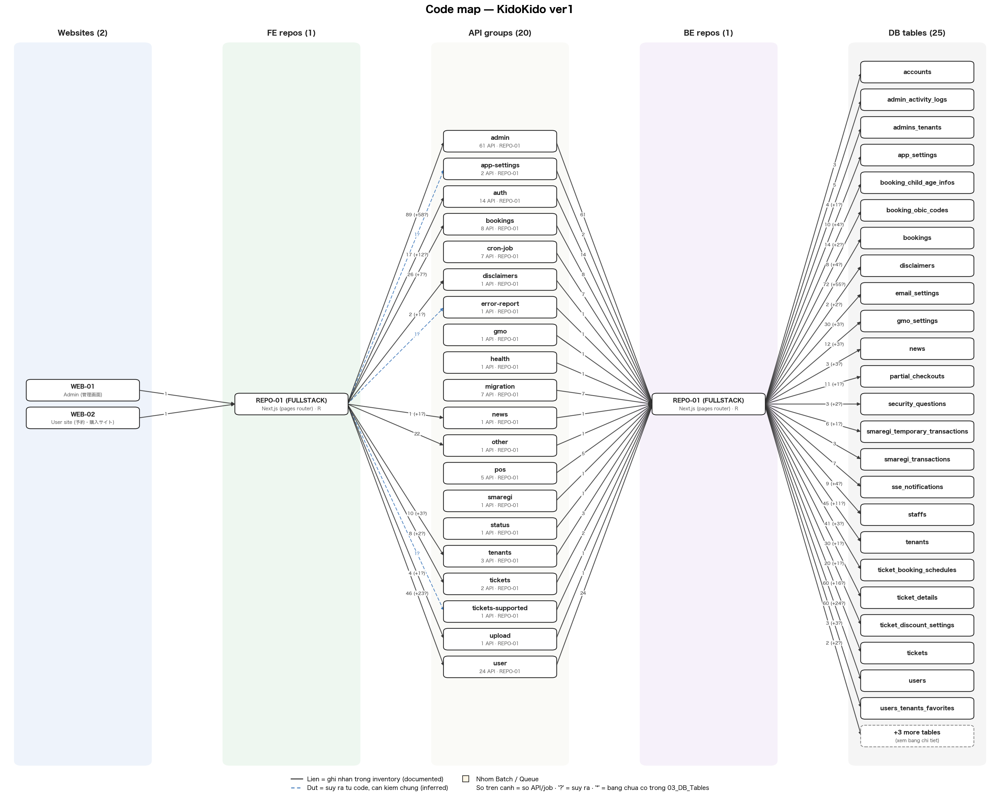

# Code map — KidoKido ver1

Lien (`-->`) = ghi nhan trong inventory · Dut (`-.->`) = suy ra tu code (fe-api-calls, table-refs), **can kiem chung** truoc khi ghi Confirmed. Node la nhom; so tren canh = so API/job.

```mermaid
flowchart LR
  subgraph L0["Websites"]
    n_site_WEB_01["WEB-01<br/>Admin (管理画面)"]
    n_site_WEB_02["WEB-02<br/>User site (予約・購入サイト)"]
  end
  subgraph L1["FE repos"]
    n_fe_REPO_01["REPO-01 (FULLSTACK)<br/>Next.js (pages router) · R"]
  end
  subgraph L2["API groups"]
    n_grp_A_REPO_01_admin["admin<br/>61 API · REPO-01"]
    n_grp_A_REPO_01_app_settings["app-settings<br/>2 API · REPO-01"]
    n_grp_A_REPO_01_auth["auth<br/>14 API · REPO-01"]
    n_grp_A_REPO_01_bookings["bookings<br/>8 API · REPO-01"]
    n_grp_A_REPO_01_cron_job["cron-job<br/>7 API · REPO-01"]
    n_grp_A_REPO_01_disclaimers["disclaimers<br/>1 API · REPO-01"]
    n_grp_A_REPO_01_error_report["error-report<br/>1 API · REPO-01"]
    n_grp_A_REPO_01_gmo["gmo<br/>1 API · REPO-01"]
    n_grp_A_REPO_01_health["health<br/>1 API · REPO-01"]
    n_grp_A_REPO_01_migration["migration<br/>7 API · REPO-01"]
    n_grp_A_REPO_01_news["news<br/>1 API · REPO-01"]
    n_grp_A_REPO_01_other["other<br/>1 API · REPO-01"]
    n_grp_A_REPO_01_pos["pos<br/>5 API · REPO-01"]
    n_grp_A_REPO_01_smaregi["smaregi<br/>1 API · REPO-01"]
    n_grp_A_REPO_01_status["status<br/>1 API · REPO-01"]
    n_grp_A_REPO_01_tenants["tenants<br/>3 API · REPO-01"]
    n_grp_A_REPO_01_tickets["tickets<br/>2 API · REPO-01"]
    n_grp_A_REPO_01_tickets_supported["tickets-supported<br/>1 API · REPO-01"]
    n_grp_A_REPO_01_upload["upload<br/>1 API · REPO-01"]
    n_grp_A_REPO_01_user["user<br/>24 API · REPO-01"]
  end
  subgraph L3["BE repos"]
    n_be_REPO_01["REPO-01 (FULLSTACK)<br/>Next.js (pages router) · R"]
  end
  subgraph L4["DB tables"]
    n_tbl_accounts["accounts"]
    n_tbl_admin_activity_logs["admin_activity_logs"]
    n_tbl_admins_tenants["admins_tenants"]
    n_tbl_app_settings["app_settings"]
    n_tbl_booking_child_age_infos["booking_child_age_infos"]
    n_tbl_booking_obic_codes["booking_obic_codes"]
    n_tbl_bookings["bookings"]
    n_tbl_disclaimers["disclaimers"]
    n_tbl_email_settings["email_settings"]
    n_tbl_gmo_settings["gmo_settings"]
    n_tbl_news["news"]
    n_tbl_partial_checkouts["partial_checkouts"]
    n_tbl_security_questions["security_questions"]
    n_tbl_smaregi_temporary_transactions["smaregi_temporary_transactions"]
    n_tbl_smaregi_transactions["smaregi_transactions"]
    n_tbl_sse_notifications["sse_notifications"]
    n_tbl_staffs["staffs"]
    n_tbl_tenants["tenants"]
    n_tbl_ticket_booking_schedules["ticket_booking_schedules"]
    n_tbl_ticket_details["ticket_details"]
    n_tbl_ticket_discount_settings["ticket_discount_settings"]
    n_tbl_tickets["tickets"]
    n_tbl_users["users"]
    n_tbl_users_tenants_favorites["users_tenants_favorites"]
    n_tbl__more["+3 more tables<br/>(xem bang chi tiet)"]
  end
  n_site_WEB_01 -->|"1"| n_fe_REPO_01
  n_site_WEB_02 -->|"1"| n_fe_REPO_01
  n_grp_A_REPO_01_admin -->|"61"| n_be_REPO_01
  n_fe_REPO_01 -->|"89 +58?"| n_grp_A_REPO_01_admin
  n_be_REPO_01 -->|"60 +24?"| n_tbl_users
  n_be_REPO_01 -->|"10 +4?"| n_tbl_app_settings
  n_be_REPO_01 -->|"72 +55?"| n_tbl_bookings
  n_be_REPO_01 -->|"60 +16?"| n_tbl_tickets
  n_be_REPO_01 -->|"41 +3?"| n_tbl_ticket_booking_schedules
  n_be_REPO_01 -->|"30 +3?"| n_tbl_email_settings
  n_be_REPO_01 -->|"45 +11?"| n_tbl_tenants
  n_be_REPO_01 -->|"30 +1?"| n_tbl_ticket_details
  n_be_REPO_01 -->|"20 +1?"| n_tbl_ticket_discount_settings
  n_be_REPO_01 -->|"14 +2?"| n_tbl_booking_child_age_infos
  n_be_REPO_01 -->|"11 +1?"| n_tbl_partial_checkouts
  n_be_REPO_01 -->|"8 +4?"| n_tbl_booking_obic_codes
  n_be_REPO_01 -->|"12 +3?"| n_tbl_gmo_settings
  n_be_REPO_01 -->|"7"| n_tbl_sse_notifications
  n_be_REPO_01 -->|"9 +4?"| n_tbl_staffs
  n_be_REPO_01 -->|"5"| n_tbl_admin_activity_logs
  n_be_REPO_01 -->|"6 +1?"| n_tbl_smaregi_temporary_transactions
  n_be_REPO_01 -->|"3"| n_tbl_smaregi_transactions
  n_be_REPO_01 -->|"2 +2?"| n_tbl_disclaimers
  n_be_REPO_01 -->|"3 +3?"| n_tbl_news
  n_be_REPO_01 -->|"4 +1?"| n_tbl_admins_tenants
  n_be_REPO_01 -->|"3"| n_tbl_accounts
  n_grp_A_REPO_01_app_settings -->|"2"| n_be_REPO_01
  n_grp_A_REPO_01_auth -->|"14"| n_be_REPO_01
  n_be_REPO_01 -->|"3 +2?"| n_tbl_security_questions
  n_fe_REPO_01 -->|"17 +12?"| n_grp_A_REPO_01_auth
  n_grp_A_REPO_01_bookings -->|"8"| n_be_REPO_01
  n_fe_REPO_01 -->|"26 +7?"| n_grp_A_REPO_01_bookings
  n_grp_A_REPO_01_cron_job -->|"7"| n_be_REPO_01
  n_grp_A_REPO_01_disclaimers -->|"1"| n_be_REPO_01
  n_fe_REPO_01 -->|"2 +1?"| n_grp_A_REPO_01_disclaimers
  n_grp_A_REPO_01_error_report -->|"1"| n_be_REPO_01
  n_grp_A_REPO_01_gmo -->|"1"| n_be_REPO_01
  n_grp_A_REPO_01_health -->|"1"| n_be_REPO_01
  n_grp_A_REPO_01_migration -->|"7"| n_be_REPO_01
  n_grp_A_REPO_01_news -->|"1"| n_be_REPO_01
  n_fe_REPO_01 -->|"1 +1?"| n_grp_A_REPO_01_news
  n_grp_A_REPO_01_pos -->|"5"| n_be_REPO_01
  n_grp_A_REPO_01_smaregi -->|"1"| n_be_REPO_01
  n_grp_A_REPO_01_status -->|"1"| n_be_REPO_01
  n_grp_A_REPO_01_tenants -->|"3"| n_be_REPO_01
  n_fe_REPO_01 -->|"10 +3?"| n_grp_A_REPO_01_tenants
  n_grp_A_REPO_01_tickets_supported -->|"1"| n_be_REPO_01
  n_grp_A_REPO_01_tickets -->|"2"| n_be_REPO_01
  n_fe_REPO_01 -->|"8 +2?"| n_grp_A_REPO_01_tickets
  n_grp_A_REPO_01_upload -->|"1"| n_be_REPO_01
  n_fe_REPO_01 -->|"4 +1?"| n_grp_A_REPO_01_upload
  n_grp_A_REPO_01_user -->|"24"| n_be_REPO_01
  n_fe_REPO_01 -->|"46 +23?"| n_grp_A_REPO_01_user
  n_be_REPO_01 -->|"3 +3?"| n_tbl_users_tenants_favorites
  n_grp_A_REPO_01_other -->|"1"| n_be_REPO_01
  n_fe_REPO_01 -->|"22"| n_grp_A_REPO_01_other
  n_fe_REPO_01 -.->|"1?"| n_grp_A_REPO_01_app_settings
  n_fe_REPO_01 -.->|"1?"| n_grp_A_REPO_01_error_report
  n_fe_REPO_01 -.->|"1?"| n_grp_A_REPO_01_tickets_supported
  n_be_REPO_01 -->|"2 +2?"| n_tbl__more
```

## Man hinh -> API -> Bang

| Screen ID | Site | Route | API (documented) | API (inferred) | Tables (documented) | Tables (inferred) |
|---|---|---|---|---|---|---|
| SC-001 | WEB-01 | /admin | — | — | — | — |
| SC-002 | WEB-01 | /admin/app-settings | API-003, API-143 | — | app_settings | — |
| SC-003 | WEB-01 | /admin/barcode-scanner | API-049 | — | tenants | — |
| SC-004 | WEB-01 | /admin/booking-management | API-015, API-018, API-019, API-022, API-041, API-050, API-082, API-117, API-143 | — | admin_activity_logs, admins_tenants, bookings, email_settings, gmo_settings, sse_notifications, staffs, tenants, ticket_booking_schedules, ticket_details, ticket_discount_settings, tickets, users | — |
| SC-005 | WEB-01 | /admin/booking-management/details/:id | API-013, API-080 | — | app_settings, booking_child_age_infos, bookings, email_settings, gmo_settings, partial_checkouts, tenants, ticket_booking_schedules, ticket_details, tickets, users | — |
| SC-006 | WEB-01 | /admin/booking-management/partial-checkout/:id | — | — | — | — |
| SC-007 | WEB-01 | /admin/booking-management/update/:id | API-013, API-080, API-085, API-121, API-143 | — | app_settings, booking_child_age_infos, bookings, email_settings, gmo_settings, partial_checkouts, tenants, ticket_booking_schedules, ticket_details, tickets, users | — |
| SC-008 | WEB-01 | /admin/booking-queue | API-005, API-006, API-007, API-008 | — | app_settings, bookings, tenants, ticket_booking_schedules, tickets, users | — |
| SC-009 | WEB-01 | /admin/booking-vacancies | API-009, API-143 | — | bookings, ticket_booking_schedules, tickets | — |
| SC-010 | WEB-01 | /admin/change-email | API-065 | — | users | — |
| SC-011 | WEB-01 | /admin/change-password | API-066 | — | users | — |
| SC-012 | WEB-01 | /admin/dashboard | API-024, API-025, API-026, API-027, API-028, API-050, API-057 | — | admins_tenants, bookings, tenants, ticket_booking_schedules, ticket_details, ticket_discount_settings, tickets, users | TotalUserBookingsGroup, user_first_bookings |
| SC-013 | WEB-01 | /admin/disclaimer-management | API-031 | — | disclaimer_options, disclaimers | — |
| SC-014 | WEB-01 | /admin/email-settings | API-033, API-034 | — | email_settings | — |
| SC-015 | WEB-01 | /admin/email-settings/edit/:emailKey | API-033, API-034, API-035 | — | email_settings | — |
| SC-016 | WEB-01 | /admin/forgot-password | API-069 | — | email_settings, users | — |
| SC-017 | WEB-01 | /admin/gmo-settings | API-037, API-143 | — | gmo_settings | — |
| SC-018 | WEB-01 | /admin/gmo-settings/create | API-037, API-143 | — | gmo_settings | — |
| SC-019 | WEB-01 | /admin/gmo-settings/edit/:id | API-037, API-143 | — | gmo_settings | — |
| SC-020 | WEB-01 | /admin/gmo-settings/view/:id | API-041, API-143 | — | users | — |
| SC-021 | WEB-01 | /admin/news-management | API-039, API-143 | — | news | — |
| SC-022 | WEB-01 | /admin/news-management/create | API-039, API-143 | — | news | — |
| SC-023 | WEB-01 | /admin/news-management/edit/:newsId | API-039, API-143 | — | news | — |
| SC-024 | WEB-01 | /admin/reset-password/:token | API-072 | — | users | — |
| SC-025 | WEB-01 | /admin/revenue-management | API-042, API-044, API-050, API-057 | — | admin_activity_logs, admins_tenants, booking_child_age_infos, bookings, staffs, tenants, ticket_booking_schedules, ticket_details, ticket_discount_settings, tickets, users | — |
| SC-026 | WEB-01 | /admin/scan-management | API-015, API-018, API-019, API-049, API-050, API-117, API-143 | — | admin_activity_logs, admins_tenants, bookings, staffs, tenants, ticket_booking_schedules, ticket_details, ticket_discount_settings, tickets, users | — |
| SC-027 | WEB-01 | /admin/signin | API-067, API-070, API-073 | — | admins_tenants, email_settings, security_questions, users | — |
| SC-028 | WEB-01 | /admin/staff-management | API-001 | — | users | — |
| SC-029 | WEB-01 | /admin/staff-management/create | API-046, API-047, API-050 | — | admins_tenants, staffs, tenants, users | — |
| SC-030 | WEB-01 | /admin/staff-management/edit/:id | API-046, API-047, API-050 | — | admins_tenants, staffs, tenants, users | — |
| SC-031 | WEB-01 | /admin/tenant-management | API-049, API-050, API-075 | — | admins_tenants, tenants, users | — |
| SC-032 | WEB-01 | /admin/tenant-management/create | API-037, API-049, API-050, API-118 | — | admins_tenants, gmo_settings, tenants, users | — |
| SC-033 | WEB-01 | /admin/tenant-management/edit/:tenantCode | API-037, API-049, API-050, API-118 | — | admins_tenants, gmo_settings, tenants, users | — |
| SC-034 | WEB-01 | /admin/tenant-management/view/:tenantCode | API-041, API-049 | — | tenants, users | — |
| SC-035 | WEB-01 | /admin/ticket-management | API-050, API-055, API-057 | — | admins_tenants, tenants, ticket_booking_schedules, ticket_details, ticket_discount_settings, tickets, users | — |
| SC-036 | WEB-01 | /admin/ticket-management/create | API-049, API-050, API-051, API-052, API-055, API-056, API-057, API-118 | — | admins_tenants, booking_obic_codes, bookings, tenants, ticket_booking_schedules, ticket_details, ticket_discount_settings, tickets, users | — |
| SC-037 | WEB-01 | /admin/ticket-management/edit/:ticketId | API-049, API-050, API-051, API-052, API-055, API-056, API-057, API-118 | — | admins_tenants, booking_obic_codes, bookings, tenants, ticket_booking_schedules, ticket_details, ticket_discount_settings, tickets, users | — |
| SC-038 | WEB-01 | /admin/ticket-management/view/:ticketId | API-049, API-055 | — | tenants, tickets | — |
| SC-039 | WEB-01 | /admin/unlock-account/:token | API-075 | — | users | — |
| SC-040 | WEB-01 | /admin/user-management | API-060, API-061 | — | admin_activity_logs, bookings, email_settings, staffs, users | — |
| SC-041 | WEB-01 | /admin/user-management/create | API-060, API-061 | — | admin_activity_logs, bookings, email_settings, staffs, users | — |
| SC-042 | WEB-01 | /admin/user-management/edit/:userId | API-060, API-061 | — | admin_activity_logs, bookings, email_settings, staffs, users | — |
| SC-043 | WEB-01 | /admin/user-management/view/:userId | API-041, API-060 | — | users | — |
| SC-044 | WEB-01 | /admin/vacancies-status | API-057, API-085 | — | app_settings, bookings, tenants, ticket_booking_schedules, ticket_details, ticket_discount_settings, tickets | — |
| SC-045 | WEB-01 | /admin/waiting-time-management | API-143 | — | — | — |
| SC-046 | WEB-02 | / | API-104, API-114, API-133 | — | news, tenants, users | — |
| SC-047 | WEB-02 | /403 | — | — | — | — |
| SC-048 | WEB-02 | /booking/buy-monthly-ticket | API-079, API-080, API-114, API-117, API-133, API-134, API-135, API-136, API-143 | — | app_settings, booking_child_age_infos, bookings, email_settings, gmo_settings, partial_checkouts, tenants, ticket_booking_schedules, ticket_details, ticket_discount_settings, tickets, users | — |
| SC-049 | WEB-02 | /booking/buy-times-limit-ticket | API-080, API-114, API-117, API-133, API-134, API-135, API-136, API-143 | — | app_settings, booking_child_age_infos, bookings, email_settings, gmo_settings, partial_checkouts, tenants, ticket_booking_schedules, ticket_details, ticket_discount_settings, tickets, users | — |
| SC-050 | WEB-02 | /booking/payment-online | API-079, API-080, API-085, API-093, API-114, API-117, API-133, API-134, API-135, API-136 | — | app_settings, booking_child_age_infos, bookings, disclaimer_options, disclaimers, email_settings, gmo_settings, partial_checkouts, tenants, ticket_booking_schedules, ticket_details, ticket_discount_settings, tickets, users | — |
| SC-051 | WEB-02 | /booking/payment-online-failure | — | — | — | — |
| SC-052 | WEB-02 | /booking/payment-online-monthly-ticket-success | — | — | — | — |
| SC-053 | WEB-02 | /booking/payment-online-success | — | — | — | — |
| SC-054 | WEB-02 | /booking/use-in-day | API-084, API-085, API-093, API-114, API-117, API-122, API-123, API-124, API-126, API-127, API-131, API-133, API-143 | — | app_settings, booking_child_age_infos, bookings, disclaimer_options, disclaimers, email_settings, partial_checkouts, smaregi_temporary_transactions, tenants, ticket_booking_schedules, ticket_details, ticket_discount_settings, tickets, users | — |
| SC-055 | WEB-02 | /commercial-law | — | — | — | — |
| SC-056 | WEB-02 | /error | — | — | — | — |
| SC-057 | WEB-02 | /forgot-password | API-069 | — | email_settings, users | — |
| SC-058 | WEB-02 | /maintenance | — | — | — | — |
| SC-059 | WEB-02 | /price-list | API-114, API-117 | — | tenants, ticket_booking_schedules, ticket_details, ticket_discount_settings, tickets | — |
| SC-060 | WEB-02 | /privacy-policy | — | — | — | — |
| SC-061 | WEB-02 | /reset-password/:token | API-072 | — | users | — |
| SC-062 | WEB-02 | /reset-password/success | — | — | — | — |
| SC-063 | WEB-02 | /signin | API-071 | — | email_settings, users | — |
| SC-064 | WEB-02 | /signup | API-071, API-074, API-132 | — | email_settings, users | — |
| SC-065 | WEB-02 | /signup-success | API-071 | — | email_settings, users | — |
| SC-066 | WEB-02 | /tenant-list | API-085, API-114, API-141, API-142 | — | app_settings, bookings, tenants, ticket_booking_schedules, tickets, users_tenants_favorites | — |
| SC-067 | WEB-02 | /tenant/:code | API-085, API-113, API-117, API-141, API-142 | — | app_settings, bookings, tenants, ticket_booking_schedules, ticket_details, ticket_discount_settings, tickets, users_tenants_favorites | — |
| SC-068 | WEB-02 | /terms-of-use | — | — | — | — |
| SC-069 | WEB-02 | /user/my-page | — | — | — | — |
| SC-070 | WEB-02 | /user/my-page/booking-history | API-080, API-085, API-122, API-129 | — | app_settings, booking_child_age_infos, bookings, email_settings, gmo_settings, partial_checkouts, smaregi_temporary_transactions, tenants, ticket_booking_schedules, ticket_details, ticket_discount_settings, tickets, users | — |
| SC-071 | WEB-02 | /user/my-page/booking-history/:id | API-080, API-082, API-121, API-143 | — | app_settings, booking_child_age_infos, bookings, email_settings, gmo_settings, partial_checkouts, tenants, ticket_booking_schedules, ticket_details, tickets, users | — |
| SC-072 | WEB-02 | /user/my-page/booking-history/cancel-success | — | — | — | — |
| SC-073 | WEB-02 | /user/my-page/booking-history/partial-checkout/:id | API-080, API-121, API-143 | — | app_settings, booking_child_age_infos, bookings, email_settings, gmo_settings, partial_checkouts, tenants, ticket_booking_schedules, ticket_details, tickets, users | — |
| SC-074 | WEB-02 | /user/my-page/booking-history/partial-checkout/success | — | — | — | — |
| SC-075 | WEB-02 | /user/my-page/booking-history/update | — | — | — | — |
| SC-076 | WEB-02 | /user/my-page/booking-history/update/:id | API-080, API-085, API-114, API-121 | — | app_settings, booking_child_age_infos, bookings, email_settings, gmo_settings, partial_checkouts, tenants, ticket_booking_schedules, ticket_details, tickets, users | — |
| SC-077 | WEB-02 | /user/my-page/booking-history/update/completed | — | — | — | — |
| SC-078 | WEB-02 | /user/my-page/delete-account | API-138 | — | accounts, email_settings, users | — |
| SC-079 | WEB-02 | /user/my-page/favorite-tenants | API-085, API-141, API-142 | — | app_settings, bookings, tenants, ticket_booking_schedules, tickets, users_tenants_favorites | — |
| SC-080 | WEB-02 | /user/my-page/monthly-ticket-status | API-078, API-125, API-127, API-143 | — | booking_child_age_infos, bookings, tenants, ticket_booking_schedules, ticket_details, ticket_discount_settings, tickets | — |
| SC-081 | WEB-02 | /user/my-page/personal-info | API-134, API-136, API-138 | — | accounts, email_settings, users | — |
| SC-082 | WEB-02 | /user/my-page/personal-info/change-credit-card | API-135, API-136 | — | email_settings, users | — |
| SC-083 | WEB-02 | /user/my-page/personal-info/change-credit-card/delete | — | — | — | — |
| SC-084 | WEB-02 | /user/my-page/personal-info/change-credit-card/success | — | — | — | — |
| SC-085 | WEB-02 | /user/my-page/personal-info/change-password | API-076 | — | email_settings, users | — |
| SC-086 | WEB-02 | /user/my-page/personal-info/update-information | API-138 | — | accounts, email_settings, users | — |
| SC-087 | WEB-02 | /user/my-page/personal-info/update-information/success | — | — | — | — |
| SC-088 | WEB-02 | /user/my-page/personal-info/update-information/verify-edit-email/:token | API-137, API-143 | — | users | — |
| SC-089 | WEB-02 | /user/my-page/personal-info/update-password/:token | API-072 | — | users | — |
| SC-090 | WEB-02 | /user/my-page/personal-info/update-password/success | — | — | — | — |
| SC-091 | WEB-02 | /user/my-page/times-limit-ticket-status | API-078, API-130, API-131, API-143 | — | booking_child_age_infos, bookings, tenants, ticket_booking_schedules, ticket_details, ticket_discount_settings, tickets | — |
| SC-092 | WEB-02 | /vacancy-status | API-085, API-114 | — | app_settings, bookings, tenants, ticket_booking_schedules, tickets | — |
| SC-093 | WEB-02 | /verify/:token | API-137, API-143 | — | users | — |

Bang an khoi hinh (it ket noi): disclaimer_options, TotalUserBookingsGroup, user_first_bookings
